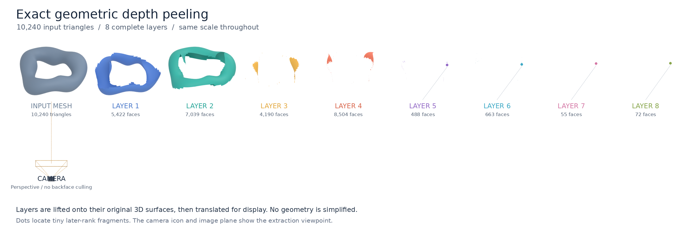
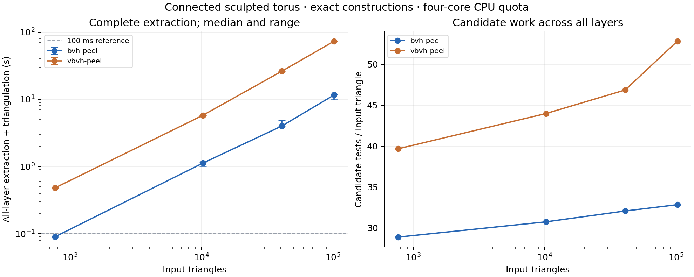

# Exact geometric depth peeling

A CPU research prototype implementing the three reference methods in
[the design](geometric_depth_peeling_design.md): a global arrangement oracle,
CGAL triangle-envelope peeling, and incremental visible-map peeling. Two accelerated convex-fragment solvers, `bvh-peel` and `vbvh-peel`, now supplement
those references. The default kernel is
`CGAL::Cartesian<CGAL::Lazy_exact_nt<CGAL::Exact_rational>>`: interval filtering
with exact rational fallback and exact constructions. Orthographic and normalized
pinhole cameras, intersecting triangles, holes, disconnected residuals, and
original-source reconstruction are implemented.

The current performance implementation is `bvh-peel`: parallel, target-relative
occlusion queries over a BVH of surviving convex patches. `vbvh-peel` implements
an [R3-inspired](https://cseweb.ucsd.edu/~ravir/lifan_vectorizer.pdf) incremental
visibility map with a balanced dynamic BVH. Both retain
hidden portions for subsequent layers and triangulate the completed layers with
original source labels. They preserve exact geometry; neither uses R3's fixed-point
rounding or convex-hull repair. See the [algorithm description](#algorithm-description).

<!-- LARGE_RESULTS_BEGIN -->
## Large connected-mesh example



The example is a connected, closed sculpted torus with **10,240 triangles**,
viewed through an oblique perspective camera. Each coloured layer is lifted onto
its original 3D source surfaces, then translated for this exploded view. All layers
are shown at the same scale; later ranks contain tiny silhouette fragments. The
renderer consumes the actual exported layer meshes. No backface culling or mesh
simplification is used. A **102,400-triangle** version tests the same shape at a
higher tessellation density.

| Input triangles | Solver | Layers | Extraction median (range) | Input setup | Output triangles |
| ---: | --- | ---: | ---: | ---: | ---: |
| 10,240 | `bvh-peel` | 8 | 1.121 s (1.007–1.142) | 0.357 s | 26,414 |
| 10,240 | `vbvh-peel` | 8 | 5.767 s (5.766–5.771) | 0.385 s | 34,768 |
| 102,400 | `bvh-peel` | 10 | 11.597 s (9.905–11.850) | 4.241 s | 201,418 |
| 102,400 | `vbvh-peel` | 10 | 73.207 s (72.907–73.295) | 4.040 s | 224,101 |

**The near-real-time target has not been reached.** These are measured complete
extractions, including conforming labelled triangulation, not extrapolated timings
or first-layer results. The plot's 100 ms line is a performance reference, not an
achieved guarantee. Different tessellations can have different maximum depth
complexity, including small extra layers near silhouettes.

Measurements use one warm-up and three subsequent extractions of the same
projected input. The table reports their median and range. Input parsing,
projection, and positive-area tie preflight are listed separately; validation and
file export are excluded. Thus these are not end-to-end animation-frame timings.
The environment has a four-core CPU quota on an Intel Xeon Platinum 8362 host.
Both methods use four threads for meshing; `vbvh-peel` updates its visibility map
sequentially. Interval filtering falls back to exact rational arithmetic, and all
constructed geometry remains exact.

Output triangle counts in the table come from the final timed repetition. Internal
convex subdivisions are not canonical: conservative interval bounds, lazy exact
evaluation and candidate traversal can change the triangulation while preserving
the source regions. The independently validated demonstration can therefore have
different face counts; both sets of counts are retained in `audits.json`.



The candidate-work plot measures this family, not a universal complexity bound.
The two solvers avoid the old per-insertion full-index rebuild and exhaustive
output-face label search. Fragmentation, repeated passes, and exact constructions
still contribute substantial cost. R3's finite-precision single-visibility results
are not directly comparable to these exact all-layer timings.

The current measurements point to visibility/clipping as the next optimization
target: it accounts for about 90% of the instrumented extraction stages in the
100K `bvh-peel` run. The next steps are stronger collective-coverage certificates,
less allocation and rational-expression work in clipping, and measured reuse
between layers with explicit invalidation. The exact solver remains the correctness
reference for any future finite-precision or GPU implementation. Neither the BVH
nor this mesh family establishes an output-independent subquadratic bound: the
number of fragments and depth layers can itself grow with the input.

[Raw measurements](results/large/summary.csv), [configuration and source hashes](results/large/config.json),
[attempts and timeouts](results/large/status.jsonl), and
[large-mesh validation](results/large/audits.json) are retained.
The [Blender scene](results/large/demo/exploded.blend) and layer OBJs in
`results/large/demo/` can be inspected separately (Git LFS is required for large files).

Reproduce the measurement and the exploded view:

```sh
python scripts/large_benchmark.py --threads 4 --timeout 360 --output results/large
python scripts/audit_large_results.py --threads 4 --directory results/large
python scripts/render_exploded.py \
  --scene results/large/scenes/sculpted-10240.json --layers results/large/demo \
  --output results/large/demo/exploded.png
python scripts/report_large_results.py results/large
```

Rendering requires Blender (the recorded figure uses 4.5.3) and Pillow; plotting
requires matplotlib. They are not part of the extraction timer.
<!-- LARGE_RESULTS_END -->

## Build and validate

Generated result files larger than 1 MiB are stored with Git LFS. After cloning,
install Git LFS and run `git lfs install` followed by `git lfs pull` to download
the complete recorded artifacts.

On Debian/Ubuntu:

```sh
sudo apt-get install libcgal-dev libgmp-dev libmpfr-dev nlohmann-json3-dev ninja-build
cmake -S . -B build -G Ninja -DCMAKE_BUILD_TYPE=Release
cmake --build build -j 2
python scripts/generate_fixtures.py
ctest --test-dir build --output-on-failure
```

OpenMP is enabled when available; `--threads 4` parallelizes the independent
queries and triangulation in `bvh-peel`. `vbvh-peel` has a sequential visibility
map update; its triangulation can run in parallel. Set `-DPEEL_LAZY_EXACT=OFF`
to build with eager exact rationals instead. Both builds have the same geometric
contract. The historical benchmark folders used the eager kernel; the new large
mesh benchmark records its own executable/source hashes and arithmetic mode.

The tested dependency versions and external reference revisions are recorded in
[dependencies.json](dependencies.json). CGAL 5.4 is installed in this environment;
the design links to 6.2 documentation. No CGAL internals or external renderer
sources are copied into this repository. Building the envelope templates can take
several minutes; limit build parallelism on machines with little memory.

```sh
build/geometric_peel --scene tests/fixtures/holes.json \
  --method visible-peel --order near-first --layers all --verify --out out/selective
build/geometric_peel --scene tests/fixtures/holes.json \
  --method envelope-peel --layers all --verify --out out/envelope
build/geometric_peel --scene tests/fixtures/holes.json \
  --method arrangement --layers all --verify --out out/oracle
build/geometric_peel --compare out/selective/exact.json out/oracle/exact.json
```

`--verify` checks exact invariants and labelled symmetric differences against the
independent arrangement method. `--validate` performs checks without constructing
the oracle, useful above the default 64-source oracle cap. For the accelerated
solvers it uses the scalable audit described below; rank checks are sampled.
`--oracle-cap N` explicitly changes that cap. `--no-accelerate` exercises the
unaccelerated insertion algorithm. Orders are `input`, `random`, `near-first`, and
`reverse`; the default seed is 1729. No backface culling is performed.

## Input and output

Scenes are JSON triangle soups; connectivity is optional. Coordinates may be
integers, rational strings such as `"1/3"`, or finite JSON floating-point numbers.
Floating-point values are converted from their stored binary64 values into exact
rationals **before** transformations. Rational strings deliberately do not accept
decimal syntax. Example:

```json
{
  "window": ["-2", "-2", "2", "2"],
  "camera": {"type": "orthographic"},
  "triangles": [
    {"id": 7, "mesh_face_id": 19,
     "vertices": [["-1", "-1", "2"], ["1", "-1", "2"], ["0", "1", "2"]]}
  ]
}
```

The camera can instead specify `"type": "perspective"` and a strictly positive
`"near": "1/10"`. An optional `world_to_camera` is an invertible exact 3×4 affine
matrix; the default is identity. Image coordinates are normalized: orthographic
`(x,y)` or perspective `(x/z,y/z)`. Express intrinsics through the input image
coordinate convention. Perspective clipping precedes division, and score is
`-1/z`; world positions and barycentrics are reconstructed on original triangles.

With the default export mode, each output directory contains:

- `exact.json`: authoritative rational source domains, scores, both camera
  transforms, labelled layers, residuals, and face-corner UV/world/barycentric data.
  Coordinates use numerator/denominator strings. Arrangement outputs also retain
  exact verification triangles and their complete depth lists.
- `layer-N.svg`: a floating-point image-plane region preview, including holes.
- `layer-N.obj`: a floating-point lifted mesh with source groups and independent
  face corners, preserving depth discontinuities.
- `metrics.json`: setup, algorithm, triangulation, validation, serialization,
  memory, output complexity, and construction/test counters.

Floating-point previews never participate in exact validation. JSON boundaries
can be weakly simple at touching vertices; the exact reader splits signed cycles
without dropping their positive-area components. Exported faces form one conforming
2D triangulation for each layer, with source boundaries preserved.

Positive-area coincident surface overlaps are explicitly rejected, including
fully hidden duplicates. Coplanar adjacent faces pass. Zero projected-area faces
are counted and omitted. Sets are regularized: isolated points and line-only
remnants do not represent standalone surfaces. This does not define boundary-ray
ownership or reproduce a GPU fill convention.

## Algorithm description

### Representation and meaning of a layer

Each original triangle `i` has an exact projected polygon `D[i]` and an affine
score `s[i](u,v) = a*u + b*v + c`. Smaller scores mean nearer: `s=z` for an
orthographic camera and `s=-1/z` for a perspective camera. Perspective projection
is clipped against the positive near plane before division. The original triangle,
source ID, and plane mapping remain fixed throughout the computation.

`R[i]` is the part of `D[i]` that has not yet appeared in an output layer. The reference
methods store it as a CGAL polygon set; the accelerated methods use convex patches.
Either representation can describe holes or disconnected components. It stores an area
of the original triangle's projection, rather than a collection of newly lifted
3D triangles. At each image point, layer `k` contains the kth nearest surface hit
in the original input, found as the nearest hit still remaining. Different parts
of one source triangle can therefore appear in different layers. Background outside another triangle's
footprint can already appear in layer 1.

The original two peeling methods share this loop, implemented in
[`run()`](src/visible_peel.cpp):

```text
R[i] = D[i] for every source i
repeat until K layers have been emitted, or all R[i] are empty:
    V = nearest_visible_regions(R)       # visible-peel or envelope-peel
    for each source i represented in V:
        R[i] = R[i] minus V[i]           # remove only its visible portion
    triangulate the completed labelled regions V and append this layer
```

A source hidden in this pass keeps its residual for later passes. Removing exactly
the nearest remaining hit at each image point exposes the next hit, so the loop
produces depth ranks without requiring a global front-to-back triangle order.
The final output is reconstructed on the original source planes. All set
operations below are regularized: boundaries and isolated line/point remnants do
not define extra layers. Positive-area depth ties are rejected during setup.

### `bvh-peel`: independent convex-fragment visibility queries

[`bvh_peel()`](src/bvh_peel.cpp) stores surviving geometry as source-labelled,
interior-disjoint convex patches per source. The initial patches are projected,
clipped input triangles. Later patches may have additional vertices. These convex
partitions are kept between layers as an acceleration representation; they are
not repeatedly converted to general polygons with holes. Standard exact JSON
export unions patches by source when materializing region boundaries.

For each layer:

1. Build a balanced spatial BVH over all surviving patches. Each node stores
   outward-rounded projected bounds and a conservative minimum ordering score.
2. Query it independently for each target patch. Reject disjoint boxes and nodes
   certified to be behind the whole target. Visit the nearer child first.
3. Start with the whole target as its visible remainder. At a candidate leaf,
   reject disjoint convex polygons with separating-axis tests. Compare the two
   affine scores; if their order changes, clip against the exact depth half-plane.
4. Subtract the candidate's occluding footprint from the current visible fragments
   using convex half-plane splits. Save the removed portions for the next layer.
   Candidates are compared only with the target's uncovered portions; their
   relative depth order is not constructed.
5. Stop querying when the target is completely covered. In that case, discard the
   temporary hidden subdivision and carry the original target patch unchanged.
6. Collect visible patches as the layer and hidden patches as the next residual.
   The candidate geometry is frozen for the entire pass, permitting parallel queries.

All broad-phase bounds enclose exact values using `CGAL::to_interval`. Fast
orientation and depth tests use directed-rounding intervals, falling back to exact
rational predicates when uncertain. Constructed intersections remain exact. No
positive-area slivers are discarded.

The hierarchy is rebuilt **once per layer**, never after each target query. With
`m` surviving patches, its median-split construction takes `O(m log m)` comparisons.
Query work depends on nodes visited and candidates surviving rejection; clipping
also depends on the generated fragment complexity. There is no explicit all-pairs
occluder loop, but dense overlaps and repeated clipping can still be expensive.
There is no unconditional linear-time or near-real-time guarantee.

`--order` changes target scheduling (or candidate order in the unaccelerated
control); the accelerated BVH itself is spatially built and traversed near-first.
`--no-accelerate` tests all other surviving patches and is a correctness control.

### `vbvh-peel`: R3-inspired dynamic visible map

The alternative in [`incremental_pass()`](src/bvh_peel.cpp) maintains a partition
of the image window into convex visible cells, including uncovered background.
A balanced dynamic AABB tree indexes the cells. Inserting a surviving patch visits
only potentially overlapping cells and compares their exact affine depths.

If every overlapped cell is nearer, the incoming patch is completely hidden and
survives unchanged, without intersection construction. If the incoming patch wins
every overlap, it is inserted whole after locally clipping the overwritten cells.
Otherwise, intersections and depth half-planes split the affected cells into convex
pieces. Only changed leaves and their ancestor bounds are updated; tree rotations
keep the hierarchy balanced. This replaces the old full-index rebuild per insertion.

Overwritten portions of old cells and hidden portions of incoming patches are
collected for the next pass. This is safe by transitivity: a portion already beaten
by another source cannot become the nearest hit later in the same insertion pass.
Temporarily visible portions are **not** prematurely removed from later layers.

The tree and visible map are rebuilt for each layer. This adapts R3's convex
representation and local hierarchy maintenance, but adds exact constructions,
depth-crossing handling, residual propagation, and conforming layer meshing. It
is not a reproduction of R3's finite-precision implementation or its benchmarks.

### Meshing and large-output modes for the accelerated solvers

Both solvers preserve source labels during clipping. To produce a conforming
layer mesh, they build a BVH over patch vertices, find vertices lying exactly on
other patch edges, and split those edges. Triangular patches remain triangles;
other convex boundaries are triangulated around an interior point. This avoids
a global arrangement and the old all-source search to label every output triangle.
Internal convex partition edges can remain as triangulation edges.

The default output still includes normalized exact JSON, SVG, OBJ and metrics.
For large experiments, `--mesh-only` writes all lifted OBJ layer meshes and metrics;
`--metrics-only` writes only metrics. **Both still compute every layer's conforming
triangulation.** These modes avoid expensive normalized JSON construction and
serialization; the reported extraction time excludes those export costs.

`--repeat N` reuses the parsed/projected input for N complete extractions, and
records every extraction time. The large benchmark discards the first as warm-up
and reports the median and range of the next three. Input setup, validation, and
export are measured separately. These timings do not represent full animation
frame latency when the camera or geometry changes.

For accelerated solvers, `--validate` uses scalable exact containment, per-source
conservation/disjointness, layer patch disjointness, and mesh area checks, plus up
to 64 independent exact camera-space ray/triangle rank checks per layer. Sampling
is not a full region-rank certificate. `--verify` retains the exhaustive small-scene
invariants, T-junction checks, and exact arrangement-oracle region comparison.

### `visible-peel`: incremental visibility within each pass

[`visible()`](src/visible_peel.cpp) maintains a map `M[source_id]` of exact polygon
sets whose interiors are disjoint. After each insertion, `M` describes the nearest
surface among the sources inserted so far. At the start of **every layer**, `M`
is empty.

For each nonempty residual source `i`, copy `R[i]` into a temporary `pending`
polygon set. Take a snapshot of candidate source IDs already in `M`. The core
insertion, without the accelerations described below, is:

```text
pending = R[i]
for each old source j in the candidate snapshot:
    if pending is empty: break
    overlap = pending intersect M[j]
    if overlap is empty: continue

    H = image-window portion of the half-plane s[i](u,v) <= s[j](u,v)
    wins  = overlap intersect H
    loses = overlap minus wins

    M[j] = M[j] minus wins
    pending = pending minus loses

if pending is nonempty:
    M[i] = pending
```

The affine score difference makes `H` a linear half-plane, including under
perspective projection. Where two triangles cross in depth, it divides their
overlap into the part won by each source. Equality along the dividing line has no
positive area. The code updates old entries as it visits them; this is safe because
old map interiors are disjoint and the new entry is inserted only after visiting
the snapshot.

Crucially, losing pieces are discarded from **temporary `pending` only**. The
persistent `R[i]` stays untouched throughout all insertions. Only the finalized
map is removed from residuals in the outer loop. Otherwise a source temporarily
visible before a later insertion could be incorrectly removed from future layers.
The final map itself becomes the layer; there is no all-rank subdivision to slice
apart in this method.

The default `near-first` order sorts sources by the minimum score at the four
corners of each residual's bounding box. This is a conservative lower bound and
an insertion heuristic, not a valid global depth order. `input`, seeded `random`,
and `reverse` (reverse input order) are also available. The order is chosen again
for each pass; exact positive-area results must agree across orders.

The accelerated path adds these tests before constructing overlap polygons:

| Test | Actual implementation | What it avoids |
| --- | --- | --- |
| Projected bounds | Query an xmin-sorted list of visible component boxes; return deduplicated source IDs whose boxes overlap the incoming box | Polygon operations on excluded sources |
| Complete occlusion | One hole-free convex visible component must contain all four corners of the incoming bounding rectangle, with a strictly nearer score at every corner | The entire incoming insertion, including polygon differences |
| Depth separation | Evaluate the affine score difference at all corners of the current pending box | The overlap/half-plane construction; one polygon difference still clips coverage |

If incoming `i` is nearer throughout that box, the depth shortcut performs
`M[j] = M[j] minus pending`. If old `j` is nearer, it performs
`pending = pending minus M[j]`. If neither is certified, it uses the full overlap
and half-plane steps above. Failed certificates always fall back to exact work.
`--no-accelerate` visits all nonempty old entries and uses the core insertion.

The component index is rebuilt after every insertion that was not rejected by the
complete-occlusion certificate, even if that insertion leaves the map unchanged.
It scans a sorted prefix and filters the other box bounds; it is not a BVH.
Candidate IDs are visited in source-ID order, not depth order. Each candidate
refers to the source's whole polygon set, potentially containing several components.

### Two examples of what is peeled

If a foreground triangle `F` completely covers a background triangle `B`, layer 1
contains `F`, and only `R[F]` is removed. `R[B]` survives unchanged and appears in
layer 2. Inserting `F` first can reject `B` without polygon Boolean operations
when the single-component bounding-rectangle certificate succeeds. Containment
of `B` itself does not guarantee containment of its bounding rectangle. Inserting
`B` first builds temporary background visibility before `F` replaces it.

For a crossing example, suppose two triangles have the same projected domain `D`
spanning `u=0`, with orthographic scores `s[A]=2+u` and `s[B]=2-u`. Layer 1 contains
`A` on `D intersect {u<0}` and `B` on `D intersect {u>0}`. After subtracting those
regions, layer 2 contains `B` on the left and `A` on the right. Peeling removes
visible **portions**, rather than deleting a whole triangle when any part is seen.

### `envelope-peel`: recompute a lower envelope per layer

[`envelope()`](src/envelope_peel.cpp) implements the same outer residual loop with
a different visibility subroutine:

1. Triangulate each nonempty `R[i]` independently, including holes/components.
2. Lift each adapter triangle to `(u,v,s[i](u,v))` and attach its original source ID.
3. Call CGAL's `lower_envelope_3` on all those graph triangles.
4. Extract bounded covered faces, subtract their hole cycles, and union faces
   belonging to the same original source.
5. Return those labelled polygon sets as `V` to the outer loop.

Under perspective, the graph coordinate is `-1/z`, not `z`. Adapter triangulation
edges are dissolved when regions are unioned by source; they do not become stored
residual boundaries. The adapter triangles and envelope diagram are rebuilt each
pass. CGAL may construct intermediate hidden subdivisions internally; this
baseline does not certify that such work is avoided.

### `arrangement`: build the subdivision for all ranks

[`arrangement()`](src/arrangement_oracle.cpp) is the independent small-scene oracle:

1. Insert all initial projected domain boundaries and the image-window boundary.
2. For every pair with overlapping domains, insert the segment where their affine
   scores are equal, clipped to their overlap, when such a segment exists.
3. Split segments at exact intersections and form a constrained triangulation.
4. At each triangle's interior barycenter, find all covering sources and sort
   their scores. Coverage and depth order are constant throughout its interior.
5. Assign that cell to the requested depth ranks, union cells by source and rank,
   then triangulate each normalized output layer.

Even `--layers 1` builds the full subdivision and sorts complete depth lists.
Unioning cells can give minimal foreground output after substantial hidden work
has already occurred. The default 64-source cap keeps this oracle tractable; it
is not used inside either peeling algorithm unless requested by `--verify`.

### Triangulation, reconstruction, and scope of the prototype

The three reference methods use [`triangulate()`](src/triangulate_export.cpp),
which collects the completed layer's outer
and hole boundaries, splits them at intersections and shared endpoints with a
CGAL arrangement, and constructs one constrained Delaunay triangulation. It labels
each triangle by testing an interior point against the source regions and discards
uncovered cells. This arrangement contains **that layer's final boundaries**;
other layers' boundaries are not added to it. Original source boundaries remain
constraints, including between adjacent coplanar input faces.

[`lift()`](src/camera.cpp) maps each output corner back to the owning original
plane: `(u,v,s)` in orthographic camera coordinates, or `(u/q,v/q,1/q)` with
`q=-s` under perspective, followed by the inverse camera transform. Corners on
opposite sides of a depth jump retain separate 3D positions and source barycentrics.
Exported triangles are derived output and never become next-pass residuals.

The original `visible-peel` implementation follows the repeated-pass polygon-set
prototype in sections 5–6 of the
[design](geometric_depth_peeling_design.md). Its performance scope is specific:

- All nonempty residual sources are enumerated each pass. Only residual polygon
  sets and fixed source/camera data are reused; there is no persistent depth order,
  visibility graph, or local reveal/update when a foreground region is removed.
- The visible-map index has projected boxes only. It provides neither hierarchical
  depth pruning nor a certificate for coverage by several visible components.
- Polygon clipping uses general CGAL polygon-set Boolean operations, which can
  construct arrangements internally. Skipping an explicit global all-rank
  arrangement does not mean every hidden intersection is avoided.
- Input mesh adjacency is not used to traverse connected surfaces. For identical
  constant-depth stacked footprints, the implementation revisits remaining sources
  each pass; a sort-once solution is possible but is not implemented here.

Consequently, the measurements characterize these implementations. They do not
measure a persistent depth-aware hierarchy or establish a lower bound for peeling.

## Validation

The fixture driver compares all five methods and insertion orders, unaccelerated
variants, and independent K=1,2,4 prefixes against all-layer results. Exact checks
cover source containment, per-source conservation and disjointness, layer
uniqueness, rank regions, positive triangulation area, triangle overlap, T-junctions,
region equality, original-plane barycentrics, and reprojection. All-layer runs
also check completion and projected area with multiplicity. The cyclic fixture
certifies strict cyclic depth inequalities over overlap closures and absence of a
triple overlap. Fixed-seed random soups supplement the named degeneracy fixtures.

## Experiments

```sh
python -m pip install 'matplotlib==3.10.9'
python scripts/benchmark.py --suite all --output results/benchmark \
  --timeout 5 --budget 600 --memory-mib 2048
python scripts/plot_results.py results/benchmark
```

The runner uses one validation/warm-up run and three measured repetitions, with
separate processes, a per-process wall-clock and address-space cap, and a total
suite budget. Failed, timed-out, capped, and budget-exhausted cases remain in
`status.jsonl`. Successful measurements are in `runs.jsonl` and `summary.csv`;
plots show median and range. All fixture/camera manifests are saved in `scenes/`.
The default foreground sweep uses g=2,4,8,16,32,64, all insertion orders, and
K=1,2,4,all, with and without the foreground. Other suites exercise stacks,
disjoint projections, holes, crossings, perspective, and generated closed meshes.

Algorithm timing includes visibility, residual updates, and final triangulation.
Projection/preflight, validation, and serialization are reported separately.
Envelope adapter triangulation and envelope construction have separate sub-timers.
`materialized_result_boundary_vertices` counts vertices in the returned Boolean
results, including repeated materialization; it is **not** CGAL's number of
internal constructed vertices. Actual arrangement vertices/edges are separately
available. Internal CGAL construction and peak-live-geometry counters are `null`.
`peak_live_boundary_vertices_lower_bound` counts visible-map and residual boundaries;
process peak RSS provides the whole-process memory observation. Certificate tests,
index box tests, candidate comparisons, intersections, differences, and half-plane
clips are distinct counters. Validation never contributes to algorithm counters.

See [results/findings.md](results/findings.md) for measured results and limitations.
This is a reference prototype: no GPU implementation, differentiation, production
mesh loader, or claim of novelty in polygon visibility is included.

## Reference implementation and licenses

The CGAL envelope and triangulation API examples linked in the design informed the
adapters. The implementation uses exact constructions and labelled classification,
including hole cycles, rather than the example's outer-boundary printer and
single-polygon parity marking. CGAL's Envelope_3, Boolean_set_operations_2,
Arrangement_on_surface_2, and Triangulation_2 packages are GPL-3.0-or-later or
commercially licensed; see their installed headers and the CGAL license files
before redistributing a linked build. This repository does not vendor CGAL.

The vectorizer archive at revision recorded in `dependencies.json` was inspected
for BVH traversal, convex splitting, and merging. Its integer rounding, convex-hull
repair, and area thresholds are not used here. No archive source was incorporated.
All generated scenes are original synthetic fixtures provided as CC0-1.0 data;
connected meshes are rational gridded, sheared closed boxes, with camera and
backface settings recorded in their manifests.

For additional many-hole and nested-surface workloads, run
`python scripts/benchmark.py --suite broader --output results/broader`. These
include 17/65-source perforated scenes and closed nested boxes with 96/1176 faces
and up to four ray hits. The supplemental suite is separate from the default
budgeted `all` sweep so it can receive its own explicit budget.

`bash scripts/reproduce.sh` runs the validation, separately budgeted suites, plots,
and retained example exports in sequence. Benchmark filters `--methods`, `--orders`,
`--layers`, and `--only-workloads` support focused reruns. The recorded benchmark
configuration and executable SHA-256 identify each run; results are machine- and
load-dependent.

The identical-footprint stack is an implementation diagnostic, not a representative
3D mesh workload or a lower bound for peeling. Constant-depth identical footprints
can be sorted once and emitted without repeated source scans. The next comparison
should include that control and persistent depth-aware traversal with certified
bounds; projected-box overlap alone cannot distinguish a stack. Practical assessment
prioritizes connected geometry and K=1,2,4. The `practical` benchmark suite adds an
oblique normalized pinhole camera and a nonconvex, connected rational torus alongside
the 1,200-face box:

```sh
python scripts/benchmark.py --suite practical --methods visible-peel envelope-peel \
  --orders near-first --layers 1 2 4 --timeout 30 --budget 300 --output results/practical
```

The total suite budget stops admitting new configurations; an in-flight repetition
group can finish afterward. Per-process wall-clock and address-space caps still apply.

The 384-face faceted torus has small six-hit regions. Its K=4 benchmark is a prefix;
the retained examples also contain complete six-layer outputs from both methods.
`scripts/check_rays.py` independently intersects rational camera rays with original
3D triangles. The recorded checks cover every exported face in layers 5 and 6;
these samples supplement, and do not replace, exact region comparisons.
