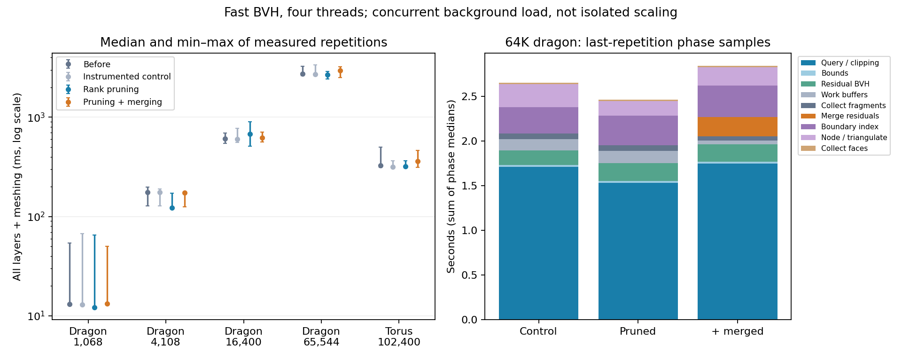

# CPU improvements that carry forward to a GPU implementation

This experiment targets redundant traversal and residual fragmentation in the
shared exact/fast peeling algorithm. It leaves the recursive BVH builder and
numeric contracts unchanged. The baseline is commit `358cbb6`, executable SHA-256
`f705c8a0351c95e5750002c89891d987946a3de5516357b32f2a748b5535f51d`.

## Implemented changes

**Rank-subtree retirement is enabled by default.** After whole-source contour
classification, each static-source BVH node stores the maximum known rank below
it. At layer `k` (zero-based), a node with maximum rank below `k` contains no
eligible occluders and can be skipped. Rank `-1` means the source is handled by
the residual BVH and was already excluded at static-tree leaves. Summaries cost
one linear pass over the existing tree; there is no per-layer rebuild of that
index. This changes traversal only, preserving candidate order and all clipping
operations. `--no-rank-pruning` restores the leaf-only control.

**Residual merging is an opt-in experiment (`--merge-residuals`).** Hidden patches
remain grouped by source. Within each group, an edge map finds full reversed
shared edges without testing every pair of patches. Two patches merge only if
the concatenated boundary is convex: every edge must support every vertex.
The arithmetic policy supplies exact filtered orientation or integer-grid
orientation. Merging introduces no vertices, snapping, hull expansion, or source
label changes. Collinear boundary vertices are retained. A 32-vertex limit bounds
individual merge work; partial shared edges and nonconvex unions are left alone.
The same grouping, adjacency lookup, union and compaction code serves both modes.
The CPU edge map is an experiment in reducing work, not a proposed GPU container.

**Instrumentation and collection.** Per-layer `phases` now separates residual
bounds, residual BVH construction, work-buffer setup, query/clipping, fragment
collection, and residual merging. Meshing separately reports boundary-point
indexing, boundary noding/face emission, and face collection. Fragment buffers
reserve their final collection sizes, avoiding repeated growth. Counters record
retired subtrees, merge attempts, successful merges, and hidden patch counts
before/after coalescing. Timers are around stages, not individual candidate tests;
query/clipping still includes their temporary allocations and polygon operations.

Existing `visibility_seconds` includes the new merging stage, when enabled.
Phase timers describe the last extraction in a process. Classification, static
index construction and other extraction overhead are outside the per-layer
phase sums; sums of median phase samples are not the median end-to-end time.

## Measurement protocol

All solvers run sequentially with four OpenMP threads and `OMP_WAIT_POLICY=PASSIVE`.
The host still has a shared four-core CPU quota and unrelated jobs remain active,
as authorized for the preceding benchmarks. These are measurements under current
load, not isolated speedups. Each paired batch alternates variant order; the
records include estimated competing CPU usage. Import/projection/topology,
preprocessing, validation and export are excluded. All layers, classification,
BVHs and conforming output triangulation are included.

The variants are the saved baseline binary, the new instrumented control with
rank pruning disabled, default rank pruning, and rank pruning plus merging.
This separates instrumentation/collection changes from traversal and coalescing.
Raw timings, commands, hashes, work counts and phase samples are retained under
[`performance/`](performance/config.json) and [`exact-performance/`](exact-performance/config.json).
The default/control performance gate is at most 20% slower than the matched
baseline. Merging is evaluated separately rather than used as a passing default.

### Fast-mode results

Three paired batches, each with one warm-up and three measured repetitions:
nine measured extractions per variant/scene. Entries below are pooled medians.

| Resolved input | Before | Instrumented control | Rank pruning (default) | Pruning + merging |
| --- | ---: | ---: | ---: | ---: |
| Dragon 1,068 | 13.1 ms | 13.0 ms | 12.2 ms | 13.3 ms |
| Dragon 4,108 | 175.2 ms | 176.2 ms | 122.2 ms | 173.9 ms |
| Dragon 16,400 | 609.7 ms | 604.3 ms | 681.1 ms | 622.6 ms |
| Dragon 65,544 | 2745.6 ms | 2697.9 ms | 2680.3 ms | 2968.8 ms |
| Torus 102,400 | 326.4 ms | 317.3 ms | 320.2 ms | 360.6 ms |

Default-mode wall-time changes range from a 30.2% improvement (4K dragon) to an
11.7% slowdown (16K dragon). The 64K change is only 2.4%; these loaded timings do
not establish a uniform speedup. All ten fast control/default gates pass. Candidate,
layer, output-triangle and peak-residual counts match the baseline in both variants.

| Scene | BVH node visits before → pruned | Peak residual patches before → merged | Output triangles before → merged |
| --- | ---: | ---: | ---: |
| dragon-1024 | 605,365 → 309,475 | 2,109 → 1,807 | 12,372 → 12,298 |
| dragon-4096 | 4,674,419 → 2,772,875 | 10,329 → 8,766 | 75,191 → 73,239 |
| dragon-16384 | 21,660,948 → 12,873,106 | 34,145 → 28,567 | 291,202 → 278,364 |
| dragon-65536 | 103,659,389 → 63,851,413 | 117,945 → 97,981 | 1,128,685 → 1,071,793 |
| torus-102400 | 6,899,732 → 5,252,054 | 19,859 → 16,953 | 187,225 → 184,215 |

Rank pruning removes 24–49% of BVH node visits across these cases. On the 64K
dragon, merging reduces the peak patch count by 16.9%, clipping candidates by
11.5%, and output triangles by 5.0%. It costs about 215 ms in median measured
merge-stage time and is 10.8% slower than pruning alone end-to-end. It remains
**opt-in**: fewer fragments did not yield a reliable net benefit.



The phase chart uses the median of the three last-repetition samples for each
stage. It excludes initial classification/static index setup and other overhead.
Its stacked sum is not the end-to-end median. Error bars on total timings show
the full measured min–max range.

### Exact-mode regression

Two paired batches, each with one warm-up and two measured extractions:
four measured extractions per variant/scene. The same numeric kernel is used
before and after; no rational precision has been relaxed.

| Resolved input | Before | Instrumented control | Rank pruning | Pruning + merging |
| --- | ---: | ---: | ---: | ---: |
| Dragon 1,068 | 1.271 s | 1.233 s | 1.260 s | 1.455 s |
| Dragon 4,108 | 6.706 s | 6.248 s | 6.738 s | 6.844 s |

All four exact control/default gates pass. Default timings are approximately
unchanged in this batch. This supports retaining the common algorithm; it is
not evidence of a large exact-mode speedup.

### What to pursue next

For the 64K default fast route, median phase samples put query/clipping at
1.53 s, residual BVH rebuilding at 0.20 s, and boundary indexing plus noding/
face emission at 0.50 s. Work-buffer setup adds 0.14 s and fragment collection
0.06 s. The builder is a secondary cost in this measurement.

The next useful experiments are coverage reuse between nearby targets and
bounds on their remaining visible regions, followed by contiguous reusable
fragment buffers and shared boundary connectivity. These remain unimplemented.
The query timer still combines traversal, polygon operations and temporary
allocation; it does not yet establish which of those dominates. Coalescing should
be revisited only with cheaper adjacency maintenance or stronger reductions,
rather than making this edge-map pass the GPU design.

No GPU timings or universal complexity improvements are claimed. The residual
and output geometry still determine the work; the early/middle layers remain
the principal target.

## Correctness and limits

The dedicated regression checks compare exact labelled regions with the original
arrangement oracle, and fast regions with that oracle under the existing numerical
acceptance budget. They cover a constructed convex hidden union, holes, disconnected
components, slivers, cyclic visibility, perspective, near-plane clipping and empty
input, with changed orders, thread counts and prefixes. The constructed union must
actually merge; a no-op cannot pass that assertion. Rank pruning additionally must
preserve exported layer geometry exactly on the tested inputs.

Merging preserves the union of its incoming convex patches, but in fast mode it
changes subsequent clipping order and rounding opportunities. It does not improve
the fast solver's numerical guarantee. Sampled large-scene rank checks are not
full region certificates, and sampling output face centroids after changing a
partition is not a matched set of rays. Existing full-dragon accuracy limitations
remain in force.

All five CTest suites passed, including **288 dedicated optimization checks**.
See [the optimization regression report](validation.json) and
[the larger dragon audits](audits/runs.json).

Both default and merged exact routes pass full source-labelled region comparisons
against the original arrangement on 136 resolved triangles and the independent
contour-aware global oracle on 528. On 4,108 triangles, both pass source
containment/disjointness/conservation, mesh-area and layer-disjointness checks;
768 default and 701 merged exact ray ranks pass with no boundary skips. Those
larger sampled ranks are not a full rank certificate. Both fast variants pass
the existing tolerance-based full-region oracle check on the 136-triangle dragon.

The 65,544-triangle fast audit **does not pass its zero-mismatch criterion**:

| Variant | Checked ranks | Mismatches | Boundary samples skipped |
| --- | ---: | ---: | ---: |
| Saved baseline | 1,913 | 19 | 135 |
| Rank pruning | 1,913 | 19 | 135 |
| Pruning + merging | 1,904 | 11 | 144 |

The baseline and default audits are identical, including mismatch examples and
area-error statistics. Rank pruning did not introduce these errors. Merging
changes the sampled face centroids, so its lower count does **not** demonstrate
improved accuracy. The experiment neither fixes nor hides finite-precision
rank errors; the exact route remains the correctness reference.

## Reproduction

Keep the baseline executable before rebuilding, or build commit `358cbb6` in a
separate checkout with the same release compiler/dependencies. Then run:

```sh
cmake -S . -B build -DCMAKE_BUILD_TYPE=Release
cmake --build build -j 2
OMP_WAIT_POLICY=PASSIVE ctest --test-dir build --output-on-failure
python3 scripts/benchmark_peel_optimizations.py --baseline-exe /path/to/before --torus
python3 scripts/benchmark_peel_optimizations.py --baseline-exe /path/to/before \
  --exact --targets 1024 4096 --batches 2 --repetitions 3 \
  --output results/cpu-transfer/exact-performance
python3 scripts/audit_peel_optimizations.py --baseline-exe /path/to/before
python3 scripts/plot_peel_optimizations.py
```
