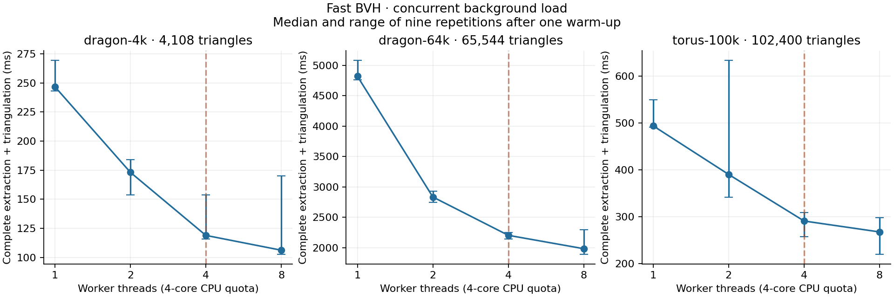

# Fast BVH thread scaling under concurrent load

The host exposes 64 physical cores and 128 logical CPUs (two Xeon Platinum
8362 sockets). This session can schedule on CPUs 0–127, but both its container
and parent pod have `cpu.max = 400000 100000`: four CPU-seconds per wall-clock
second on average, shared with other processes in the session. More worker
threads can run, but they do not increase that allocation. Eight workers test
oversubscription of the quota, not access to eight dedicated cores.

Unrelated rendering and simulation jobs were active during this batch;
background load was not controlled. These results measure throughput in
that environment; speedup ratios include contention and changes in background
activity. They are not an isolated CPU scaling experiment or directly comparable
to earlier quieter runs.

| Scene | Input triangles | 1 thread | 2 threads | 4 threads | 8 threads | Observed 1→4 speedup |
| --- | ---: | ---: | ---: | ---: | ---: | ---: |
| dragon-4k | 4,108 | 246.7 ms | 173.1 ms | 118.9 ms | 106.2 ms | 2.07× |
| dragon-64k | 65,544 | 4819.1 ms | 2834.8 ms | 2205.1 ms | 1984.8 ms | 2.19× |
| torus-100k | 102,400 | 493.9 ms | 390.2 ms | 290.8 ms | 267.5 ms | 1.70× |

Observed 1→4 speedups are 2.07× (4K dragon), 2.19× (64K dragon), and 1.70×
(100K torus). Eight threads are 8–11% faster than four in this batch. Estimated
competing CPU usage ranges from 1.49 to 3.02 cores across runs and is lower in
the higher-thread runs for each scene; this prevents attributing all gains to
intrinsic algorithm scaling. All thread counts retain the same layer, output
triangle and clipping-candidate counts for each scene.



Each process performs one warm-up and nine measured repetitions with the default
30-bit grid and `--resolved-mesh`. Values are medians; the plot shows min–max
ranges. All layers and labelled output triangulation are included. Import,
projection, topology, cached intersection preprocessing, validation and file export
are excluded. Repetitions reuse projected geometry with a fixed camera. Our own
solver jobs run sequentially with `OMP_WAIT_POLICY=PASSIVE`.

The two dragon scenes reuse the exact intersection-resolved inputs from the
[global comparison](../../global/README.md); the torus is the existing connected
102,400-face example. Fast-mode geometry is approximate. This timing experiment
does not add numerical correctness certificates. Existing
[fast-mode accuracy limitations](../../../README.md#fast-mode-with-mesh-contours)
continue to apply; the exact dragon audits do not certify fast-mode output.

`runs.json` records process CPU time and cgroup CPU/throttling counters. Estimated
other CPU usage is `(cgroup CPU time - solver CPU time) / process wall time`;
it includes orchestration overhead and is an approximate measure of competing
load over the whole process, not each extraction. Layer, triangle and clipping
candidate counts are compared across thread counts in `work-count-invariants.json`.
Equal counts do not prove geometric equality.

The initially paused batch is preserved in
[`../thread-scaling-loaded/`](../thread-scaling-loaded/interference.json).
Its completed measurements are not mixed into this table. The final batch explicitly
records competing load.

```sh
python3 scripts/benchmark_fast_threads.py
python3 scripts/plot_fast_threads.py
```

Binary/input hashes, CPU affinity, hardware description and the full cgroup limit
chain are in `config.json`. Raw repetitions and phase timings are in the per-run
`metrics.json` files; phase timings describe the last repetition.
