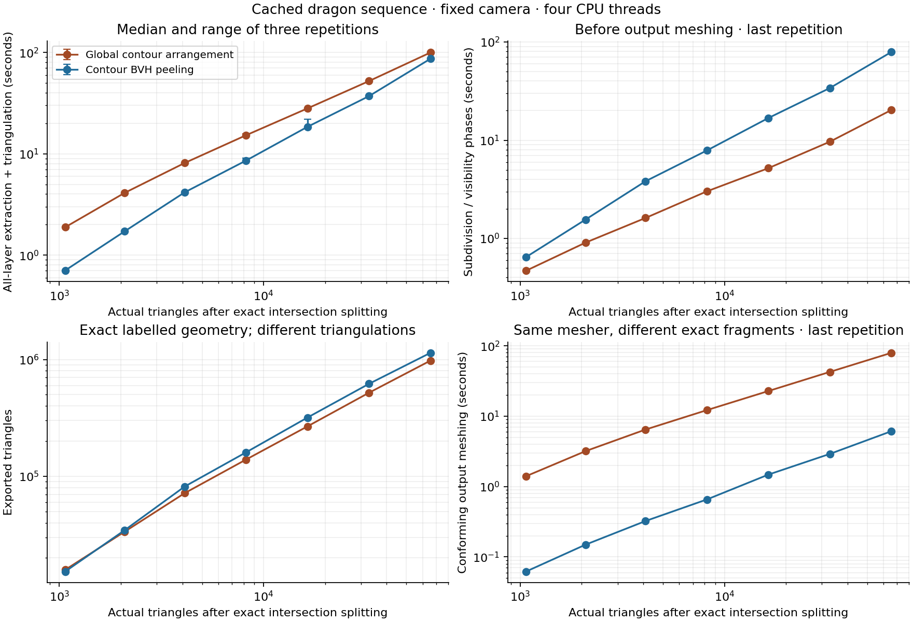

# Exact contour-aware global baseline

`global-arrangement` computes all ranks from one global subdivision. It does not
peel residuals. The original `arrangement` solver remains unchanged as an
independent small-scene correctness oracle.

## Measured comparison

| Decimation target → resolved faces | Global exact | Peeling exact | Global / peeling |
| --- | ---: | ---: | ---: |
| 1,024 → 1,068 | 1.885 s | 0.706 s | 2.67× |
| 2,048 → 2,088 | 4.117 s | 1.718 s | 2.40× |
| 4,096 → 4,108 | 8.118 s | 4.167 s | 1.95× |
| 8,192 → 8,200 | 15.229 s | 8.569 s | 1.78× |
| 16,384 → 16,400 | 28.048 s | 18.457 s | 1.52× |
| 32,768 → 32,792 | 52.151 s | 37.043 s | 1.41× |
| 65,536 → 65,544 | 99.712 s | 86.560 s | 1.15× |



Both methods use exact arithmetic and identical resolved inputs. Peeling is
faster end to end at all seven doubling levels, but global's penalty narrows from
2.67× at 1K to 1.15× at 64K. Successive doublings multiply global time by
1.84–2.18× and peeling time by 2.01–2.43×. From 8K to 64K, time grows 6.55×
for global and 10.10× for peeling. Different decimations have different geometry
and depth complexity; these are empirical trends, not asymptotic bounds or a
prediction of a crossover.

At 65,544 triangles, both methods extract 16 layers. The last measured global
repetition takes 20.29 seconds for boundary/equality discovery, arrangement
construction and source/rank assignment, then 79.36 seconds for conforming
meshing. Peeling takes 78.95 seconds for visibility/classification and 6.10 seconds
for meshing. Global emits 977,721 triangles versus peeling's 1,139,680. Peak RSS
in the repeated timing processes is 3.46 GiB global and 1.67 GiB peeling. The
observed total-time advantage does not show that iterative visibility itself is
faster; global's exact fragment representation and boundary-noding/meshing costs
need profiling. Phase plots use the last repetition, not medians of phase timings.

The extended report measures 1K, 4K, 16K and 64K and reuses the earlier 2K, 8K
and 32K timings/audits, with explicit provenance. Matching binary, resolver,
input checksums, host and benchmark settings are required. New processes use a
900-second cap. The original 32K timeouts at 180 seconds and retries at 360
seconds remain in [the earlier log](dragon/runs.json); imported records point
back to their source indices. The new report never turns a process timeout into
a per-extraction bound. See [extended attempts](dragon-doubling/runs.json),
[hardware](hardware.json) and [solver build provenance](build.json).

## Algorithm and correctness

1. Import and project the represented input exactly, using the same lazy rational
   kernel and positive-area tie rejection as the exact peeling solver. Recover
   mesh connectivity by exact world-vertex equality. Retain boundaries,
   silhouettes, non-manifold/inconsistent edges and camera-clipping boundaries.
   Omit edges with exactly two consistently oriented, same-facing incidents.
2. Build an outward-enclosing double-box BVH over original source polygons. Query
   overlapping source pairs, once per pair. Test their affine score difference
   exactly and construct the depth-equality segment in their overlap where needed.
   This step runs even with `--resolved-mesh`: the new oracle does not trust that
   assertion for omitting actual depth-order changes. A crossing along an internal
   mesh edge must be retained when it passes through the other source's interior;
   requiring strict straddling of both polygons would incorrectly omit it.
3. Construct and triangulate one exact arrangement of the retained contours,
   equality segments, and image-window boundary. CGAL's segment arrangement uses
   its bulk insertion/sweep; there is no explicit all-segment-pairs loop here.
4. Query a second BVH to intersect each source with overlapping global cells,
   using an independent exact convex intersection implementation. For each
   positive-area intersection, count the nearer original sources at an exact
   interior point using the original-source BVH. Assign the whole intersection
   to that rank. Preserve the source label; fragments beyond a requested prefix
   become residuals. The implementation counts nearer hits rather than sorting
   a full depth list, and does not yet propagate ranks across neighboring cells.
5. Node patch boundaries and triangulate the labelled layers using the same exact
   meshing routine as `bvh-peel`. Internal subdivision edges may remain in both
   implementations' convex-patch output; there is no minimal-triangulation claim.
   Exact region materialization dissolves them for comparison, outside timing.

Why a rank sample suffices: within a source/global-cell intersection, rank can
change only at another surface's coverage boundary or at a depth equality.
Coverage events are included in the contours. Crossing an omitted same-facing
internal edge replaces one incident triangle by the other at the same continuous
surface depth; it does not change the hit count or the target's rank unless the
target meets that surface, in which case the equality segments or the target's
own boundaries account for the event. Source boundaries are restored by the
source/cell intersections, so omitting internal edges globally does not lose
provenance. Cells partition the window and their intersections partition every
source, establishing conservation without iterative subtraction.

A sample on an omitted internal edge could count two incident triangles. The
solver detects exact boundary hits and retries at rational points on a parabola
strictly inside the convex fragment. A finite set of lines excludes only finitely
many points on this curve. It uses no epsilon or source-ID tie break. Positive-area
depth ties remain unsupported and are rejected before either solver runs.

This is an exact global baseline, not an optimal global algorithm. BVH queries
can degenerate; projected contours can have quadratic intersections; cell/source
intersections and per-fragment rank queries can be numerous. The global
arrangement and CDT are serial, while pair checks, source/cell clipping and output
meshing use OpenMP. Timings must not be interpreted as a universal architectural
advantage of peeling or global subdivision.

## Parallelism and a possible GPU implementation

The 4K dragon (4,108 resolved triangles, 12 layers) gives a direct CPU scaling
comparison. Values are medians of three measured extractions after one warm-up,
including output meshing. One- and two-thread jobs ran sequentially after the
size sweep; four-thread results are reused from that sweep with matching binary,
input and host. No other solver job ran concurrently.

| Exact method | 1 thread | 2 threads | 4 threads | 1→4 speedup |
| --- | ---: | ---: | ---: | ---: |
| `global-arrangement` | 11.419 s | 9.456 s | 8.118 s | 1.41× |
| `bvh-peel` | 15.695 s | 8.066 s | 4.167 s | 3.77× |

On this example, **BVH peeling scales substantially better**. Global is faster
on one thread, but peeling wins on two and four. Output triangle counts are
unchanged across these thread counts: 71,738 global and 81,735 peeling. This is
one mesh/camera on a host with a four-core quota, not a general scaling law or a
GPU benchmark. See [thread-scaling records](thread-scaling/runs.json).

The current `bvh-peel` implementation exposes independent target-triangle queries
within each layer: all workers read frozen source/residual BVHs and write private
fragment buffers. This is the most direct starting point for parallelizing the
existing fast solver. Layers still depend on earlier residuals, and successive
cuts within one target query are dependent. Variable candidate counts, fragment
sizes, allocation and BVH rebuilds limit efficiency. Whole-source contour rank
classification already bypasses peeling for certified constant-rank triangles.

`global-arrangement` parallelizes candidate-pair tests, source/cell intersections,
rank queries and per-patch output meshing. Its central CGAL arrangement/CDT is
serial. Output meshing also sorts/deduplicates vertices and builds a BVH before
its parallel patch loop, and layers are currently meshed sequentially. Once the
global cells exist, rank assignment has no dependency on previous layers. That
offers potential for all-layer workloads, but does not make the current global
implementation more scalable by itself. The measured CPU speedups above do not
establish GPU performance.

Parallelism also does not remove redundant work: the current global rank query
counts occluders separately for each fragment. Where K sources overlap, K such
queries can still do quadratic work. Sharing depth ordering across compatible
regions would require further algorithmic work, not merely additional threads.

The R3-inspired `vbvh-peel` route mutates one visibility map during incremental
insertion, which is harder to parallelize within a single view. Independent
beams or spatial tiles could own separate maps, with additional partitioning and
boundary assembly work. R3's incremental representation is described on its
[research page](https://research.nvidia.com/labs/rtr/publication/zhou2021vectorization/).
R3 reports CPU measurements and discusses adapting its method to GPUs as future
work; it is not a demonstrated GPU implementation (Sections 6 and 7 of the
[paper](https://cseweb.ucsd.edu/~ravir/lifan_vectorizer.pdf)).

For a first GPU implementation, a plausible approach is the finite-precision
BVH route with batched queries, flat fragment storage, work queues and compaction.
The exact CPU solver remains the reference. GPU conservative broad-phase queries
could also accelerate exact processing, but arbitrary-precision constructions
and CPU/GPU transfer costs make a direct exact-kernel port unattractive.

For all layers at high depth complexity, a tiled contour/event algorithm assigning
ranks without repeated full passes is also worth investigating. This is a proposed
direction, not an implemented or verified algorithm. R2 demonstrates independent
edge visibility tasks, sorting and prefix scans on a GPU, but its boundary
completion still includes pairwise depth comparisons. It therefore does not by
itself solve the concern about quadratic work in dense overlap. Reconstructing
complete labelled polygons and all layers remains necessary; retaining contour
edges alone is not a complete output algorithm. See
[R2, Sections 3 and 6](https://www.cg.tuwien.ac.at/research/publications/2013/Auzinger_2013_AnaVis/Auzinger_2013_AnaVis-Paper.pdf).

## Validation

All four CTest suites pass, including the 243 global checks. Solver code and
executable are unchanged during this extension. Both methods complete all seven
doubling levels: 14 timing jobs and 14 audits, of which six timing/audit pairs
are reused from the earlier report. All ten cached raw/indexed/resolved geometry
identities were verified, and resuming the completed sweep launches no jobs.

The earlier 72- and 136-triangle resolved meshes receive full comparisons against
the unchanged eager oracle; 72, 136 and 528 receive full global/peeling comparisons
of labelled regions. Larger levels receive exact containment, conservation,
disjointness and mesh-area checks plus independent ray-rank sampling. At 65,544
triangles, global checks 956 ray ranks and peeling checks 1,024, with no
mismatches or boundary skips. These larger audits are not full-region rank
certificates. See [extended completion](dragon-doubling/completion.json),
[extended attempts](dragon-doubling/runs.json) and
[the earlier full-region comparison record](completion.json).

`validation.json` records 243 checks: the original fixtures plus non-manifold,
omitted-internal-edge sampling and crossing-on-internal-edge regressions.
The controls turn off broad-phase pruning and contour reduction separately,
and exercise one/four threads, prefixes, positive-area tie rejection and the
new `--verify-global` interface. `--verify` compares complete source-labelled
regularized regions with the unchanged eager arrangement oracle, and also checks
containment, conservation, reconstruction and conforming triangulations.

```sh
build/geometric_peel --scene tests/fixtures/perspective_crossing.json \
  --method global-arrangement --verify --metrics-only --out out/global
build/geometric_peel --scene tests/fixtures/perspective_crossing.json \
  --method global-arrangement --global-all-edges --no-accelerate \
  --verify --metrics-only --out out/global-control
build/geometric_peel --scene tests/fixtures/perspective_crossing.json \
  --method bvh-peel --verify-global --metrics-only --out out/peel-global-check
```

The global solver does not require `--resolved-mesh`; it extracts connectivity
and handles crossing segments itself. Peeling's contour acceleration still
requires resolved input. `--verify-global` is for other exact solvers; it compares
all labelled regions against the new global baseline, with no 64-source cap.
It can be much more expensive than extraction, and is not included in timing.
`--validate` uses exact containment/conservation/disjointness checks plus sampled
independent 3D ray ranks; that audit is not a full-region rank certificate.

## Cached dragon sequence

`dragon-cache/` contains independent collapse decimations from the supplied
721,510-face dragon, with target counts 64, 128, 512, and every doubling from
1,024 through 65,536.
The original full-model camera and window are fixed for every level. These are
geometrically different meshes, not nested subsets or guarantees of equal depth
complexity. Very low resolutions lose detail and can introduce intersections.

Each level retains indexed geometry (`mesh.npz`), a raw scene, a manifest with
checksums and Blender version, and an exact intersection-resolved scene with
preprocessing provenance. Blender stores coordinates in float32; those exported
values define the exact inputs. Both solvers receive the identical resolved file,
and tables use its actual triangle count. Source IDs identify decimated/resolved
faces, not original full-dragon triangles.

Cache reuse checks input, camera, generator, resolver and output identities;
changes fail explicitly rather than silently reusing stale geometry. The cached
inputs can be used without rerunning Blender or loading the full dragon.
Model attribution and upstream terms are the same as the [full example](../dragon/README.md).

```sh
/opt/felt-monster/blender-4.5.3-linux-x64/blender --background --factory-startup \
  --threads 2 --python scripts/cache_dragon_lods.py --
python3 scripts/benchmark_global.py
python3 scripts/benchmark_global.py --resume
# Retry only timed-out solver jobs; preserve every original attempt.
python3 scripts/benchmark_global.py --resume --retry-timeouts 360
python3 scripts/plot_global.py
```

The extended doubling sweep uses the same executable and includes the earlier
2K, 8K and 32K measurements, explicitly marked `reused_from` with record indices
and metrics hashes. It measures the new 1K, 4K, 16K and 64K levels separately.
Reuse requires matching binary, resolver, host, thread count, arithmetic and
benchmark settings; each reused scene must also match its recorded checksum.
The original runs, including earlier timeouts, remain in `dragon/`. New jobs use
a 900-second process cap. To reproduce the extended report:

```sh
/opt/felt-monster/blender-4.5.3-linux-x64/blender --background --factory-startup \
  --threads 2 --python scripts/cache_dragon_lods.py -- \
  --sizes 64 128 512 1024 2048 4096 8192 16384 32768 65536
python3 scripts/benchmark_global.py --output results/global/dragon-doubling \
  --sizes 1024 2048 4096 8192 16384 32768 65536 \
  --timeout 900 --validation-timeout 900 --reuse-from results/global/dragon
# Add --resume to skip already recorded jobs with this same configuration.
python3 scripts/plot_global.py --results results/global/dragon-doubling
# Run after the size sweep, without concurrent benchmark jobs.
python3 scripts/benchmark_global_threads.py
```

Each successful timing process performs one warm-up and three measured all-layer
extractions, including conforming triangulation. Setup, cached preprocessing,
audit and serialization are reported separately. Validation runs in separate
processes: full eager-oracle comparisons at the smallest levels, direct global/
peeling region comparisons through 512 target faces, and scalable exact audits
at larger levels. All timeouts/errors are retained. The initial 180-second cap and any explicit retry cap cover
the whole requested process, not one extraction. Retry caps are recorded per
attempt in `runs.json`; the summary uses the latest attempt for each timing job.

The shared host has a four-core CPU quota; these are CPU measurements with four
OpenMP threads. The global CGAL arrangement remains serial. Measurements do not
include the finite-precision fast solver, whose numerical contract differs.
`dragon-initial/` retains an interrupted preliminary run before the internal-edge
crossing correction; use `dragon/` or `dragon-doubling/` for final comparisons.
