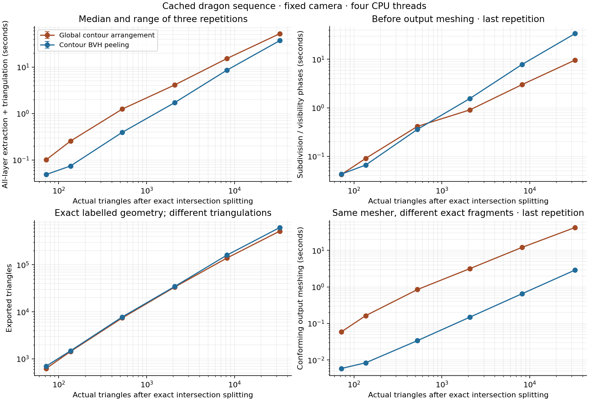

# Exact contour-aware global baseline

`global-arrangement` computes all ranks from one global subdivision. It does not
peel residuals. The original `arrangement` solver remains unchanged as an
independent small-scene correctness oracle.

## Measured comparison

| Decimation target → resolved faces | Global exact | Peeling exact | Global / peeling |
| --- | ---: | ---: | ---: |
| 64 → 72 | 0.102 s | 0.049 s | 2.07× |
| 128 → 136 | 0.256 s | 0.075 s | 3.43× |
| 512 → 528 | 1.247 s | 0.395 s | 3.16× |
| 2,048 → 2,088 | 4.117 s | 1.718 s | 2.40× |
| 8,192 → 8,200 | 15.229 s | 8.569 s | 1.78× |
| 32,768 → 32,792 | 52.151 s | 37.043 s | 1.41× |



Both methods use exact arithmetic and identical resolved inputs. Peeling is
faster end to end on these six levels, but its advantage narrows at larger sizes.
At 32,792 triangles, the last measured global repetition takes 9.65 seconds for
boundary/equality discovery, arrangement construction and source/rank assignment,
then 42.56 seconds for conforming meshing. Peeling takes 33.97 seconds for its
visibility/classification phases and 2.91 seconds for meshing. The global output
has 519,252 triangles versus peeling's 618,945. Thus the observed total-time
advantage is not evidence that iterative visibility itself is faster; the global
fragment representation and exact boundary-noding/meshing costs need profiling.
The phase plots use the last repetition, not medians of phase timings.

The initial 32K global repeated-timing job and peeling audit exceeded their
180-second process caps. The retry limit is 360 seconds, with both original
attempts retained in [runs.json](dragon/runs.json). The table selects the latest
attempt for each timing job; it never turns a process timeout into a per-extraction
lower bound. Hardware and source/executable provenance are in
[hardware.json](hardware.json) and [build.json](build.json).

## Algorithm and correctness

1. Import and project the represented input exactly, using the same lazy rational
   kernel and positive-area tie rejection as the exact peeling solver. Recover
   mesh connectivity by exact world-vertex equality. Retain boundaries,
   silhouettes, non-manifold/inconsistent edges and camera-clipping boundaries.
   Omit edges with exactly two consistently oriented, same-facing incidents.
2. Build an outward-enclosing double-box BVH over original source polygons. Query
   overlapping source pairs, once per pair. Test their affine score difference
   exactly and construct the depth-equality segment in their overlap where needed.
   This step runs even with `--resolved-mesh`: the new oracle does not trust that
   assertion for omitting actual depth-order changes. A crossing along an internal
   mesh edge must be retained when it passes through the other source's interior;
   requiring strict straddling of both polygons would incorrectly omit it.
3. Construct and triangulate one exact arrangement of the retained contours,
   equality segments, and image-window boundary. CGAL's segment arrangement uses
   its bulk insertion/sweep; there is no explicit all-segment-pairs loop here.
4. Query a second BVH to intersect each source with overlapping global cells,
   using an independent exact convex intersection implementation. For each
   positive-area intersection, count the nearer original sources at an exact
   interior point using the original-source BVH. Assign the whole intersection
   to that rank. Preserve the source label; fragments beyond a requested prefix
   become residuals. The implementation counts nearer hits rather than sorting
   a full depth list, and does not yet propagate ranks across neighboring cells.
5. Node patch boundaries and triangulate the labelled layers using the same exact
   meshing routine as `bvh-peel`. Internal subdivision edges may remain in both
   implementations' convex-patch output; there is no minimal-triangulation claim.
   Exact region materialization dissolves them for comparison, outside timing.

Why a rank sample suffices: within a source/global-cell intersection, rank can
change only at another surface's coverage boundary or at a depth equality.
Coverage events are included in the contours. Crossing an omitted same-facing
internal edge replaces one incident triangle by the other at the same continuous
surface depth; it does not change the hit count or the target's rank unless the
target meets that surface, in which case the equality segments or the target's
own boundaries account for the event. Source boundaries are restored by the
source/cell intersections, so omitting internal edges globally does not lose
provenance. Cells partition the window and their intersections partition every
source, establishing conservation without iterative subtraction.

A sample on an omitted internal edge could count two incident triangles. The
solver detects exact boundary hits and retries at rational points on a parabola
strictly inside the convex fragment. A finite set of lines excludes only finitely
many points on this curve. It uses no epsilon or source-ID tie break. Positive-area
depth ties remain unsupported and are rejected before either solver runs.

This is an exact global baseline, not an optimal global algorithm. BVH queries
can degenerate; projected contours can have quadratic intersections; cell/source
intersections and per-fragment rank queries can be numerous. The global
arrangement and CDT are serial, while pair checks, source/cell clipping and output
meshing use OpenMP. Timings must not be interpreted as a universal architectural
advantage of peeling or global subdivision.

## Validation

All four CTest suites pass, including the 243 new global checks. Both methods
complete timings and audits at all six cached sizes. The 72- and 136-triangle
resolved meshes receive full comparisons against the unchanged eager oracle;
72, 136 and 528 receive full global/peeling labelled-region comparisons. Larger
levels receive exact containment, conservation, disjointness and mesh-area
checks plus independent ray-rank sampling. At 32,792 triangles, global checks
918 ray ranks and peeling checks 1,024, with no mismatches or boundary skips.
These larger audits are not full-region rank certificates. See
[completion.json](completion.json) and [all attempts](dragon/runs.json).


`validation.json` records 243 checks: the original fixtures plus non-manifold,
omitted-internal-edge sampling and crossing-on-internal-edge regressions.
The controls turn off broad-phase pruning and contour reduction separately,
and exercise one/four threads, prefixes, positive-area tie rejection and the
new `--verify-global` interface. `--verify` compares complete source-labelled
regularized regions with the unchanged eager arrangement oracle, and also checks
containment, conservation, reconstruction and conforming triangulations.

```sh
build/geometric_peel --scene tests/fixtures/perspective_crossing.json \
  --method global-arrangement --verify --metrics-only --out out/global
build/geometric_peel --scene tests/fixtures/perspective_crossing.json \
  --method global-arrangement --global-all-edges --no-accelerate \
  --verify --metrics-only --out out/global-control
build/geometric_peel --scene tests/fixtures/perspective_crossing.json \
  --method bvh-peel --verify-global --metrics-only --out out/peel-global-check
```

The global solver does not require `--resolved-mesh`; it extracts connectivity
and handles crossing segments itself. Peeling's contour acceleration still
requires resolved input. `--verify-global` is for other exact solvers; it compares
all labelled regions against the new global baseline, with no 64-source cap.
It can be much more expensive than extraction, and is not included in timing.
`--validate` uses exact containment/conservation/disjointness checks plus sampled
independent 3D ray ranks; that audit is not a full-region rank certificate.

## Cached dragon sequence

`dragon-cache/` contains independent collapse decimations from the supplied
721,510-face dragon, with target counts 64, 128, 512, 2,048, 8,192 and 32,768.
The original full-model camera and window are fixed for every level. These are
geometrically different meshes, not nested subsets or guarantees of equal depth
complexity. Very low resolutions lose detail and can introduce intersections.

Each level retains indexed geometry (`mesh.npz`), a raw scene, a manifest with
checksums and Blender version, and an exact intersection-resolved scene with
preprocessing provenance. Blender stores coordinates in float32; those exported
values define the exact inputs. Both solvers receive the identical resolved file,
and tables use its actual triangle count. Source IDs identify decimated/resolved
faces, not original full-dragon triangles.

Cache reuse checks input, camera, generator, resolver and output identities;
changes fail explicitly rather than silently reusing stale geometry. The cached
inputs can be used without rerunning Blender or loading the full dragon.
Model attribution and upstream terms are the same as the [full example](../dragon/README.md).

```sh
/opt/felt-monster/blender-4.5.3-linux-x64/blender --background --factory-startup \
  --threads 2 --python scripts/cache_dragon_lods.py --
python3 scripts/benchmark_global.py
python3 scripts/benchmark_global.py --resume
# Retry only timed-out solver jobs; preserve every original attempt.
python3 scripts/benchmark_global.py --resume --retry-timeouts 360
python3 scripts/plot_global.py
```

Each successful timing process performs one warm-up and three measured all-layer
extractions, including conforming triangulation. Setup, cached preprocessing,
audit and serialization are reported separately. Validation runs in separate
processes: full eager-oracle comparisons at the smallest levels, direct global/
peeling region comparisons through 512 target faces, and scalable exact audits
at larger levels. All timeouts/errors are retained. The initial 180-second cap and any explicit retry cap cover
the whole requested process, not one extraction. Retry caps are recorded per
attempt in `runs.json`; the summary uses the latest attempt for each timing job.

The shared host has a four-core CPU quota; these are CPU measurements with four
OpenMP threads. The global CGAL arrangement remains serial. Measurements do not
include the finite-precision fast solver, whose numerical contract differs.
`dragon-initial/` retains an interrupted preliminary run before the internal-edge
crossing correction; use `dragon/` for the final comparison.
