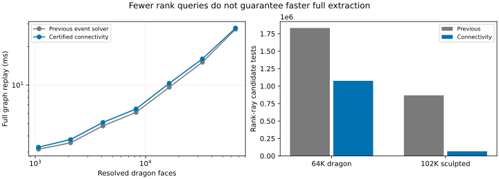

# Certified patch connectivity: GPU follow-up

16 October 2026. This pass reduces independent rank queries across connected
mesh patches. It is **not a general performance win**: the 1K–64K dragons are
2–7.3% slower, while the 102K sculpted mesh is 9.3% faster than a fresh run of
`a8082fd`. All layers and conforming world-space output are included.

## Method and timing boundary

Pure Warp 1.15.0 on an NVIDIA L40, driver 570.158.01, on the existing shared host
with a four-core CPU quota. Each case uploads and allocates, warms JIT/scratch,
captures once, replays twice to warm up, then records five CUDA-event timings.
Tables use medians; JSON retains every timing and GPU/process snapshots.
Projection, topology, BVHs, subdivision, adjacency certificates, rank queries,
sorting, boundary noding and meshing are inside the timed graph. Upload, capture,
readback, validation and rendering are outside. No benchmark GPUs run concurrently
with each other. These are current-load measurements, not isolated-machine claims.

The previous implementation is a separate checkout of committed Python sources
at `a8082fd`. Both runs use identical scene checksums and default capacities.
[Baseline](baseline.json) and [candidate](benchmark.json) include module hashes.

## Realistic scaling

| Resolved faces | Previous (ms) | Connectivity (ms) | Change |
| --- | ---: | ---: | ---: |
| 1,068 dragon | 3.153 | 3.273 | +3.8% |
| 2,088 dragon | 3.545 | 3.753 | +5.9% |
| 4,108 dragon | 4.796 | 5.107 | +6.5% |
| 8,200 dragon | 6.123 | 6.507 | +6.3% |
| 16,400 dragon | 9.615 | 10.313 | +7.3% |
| 32,792 dragon | 15.070 | 16.009 | +6.2% |
| 65,544 dragon | 27.300 | 27.874 | +2.1% |
| 102,400 sculpted | 21.155 | 19.192 | -9.3% |



For the 64K dragon, independent ray groups fall from **126,916 to 57,534** and
rank-ray candidates from **1,832,438 to 1,076,081**. The adjacency pass certifies
85,441 links (including redundant links), leaving 59,778 rank components, and
performs 183,335 contour candidate tests. Its cost offsets the saved ray work.

For the sculpted mesh, ray groups fall from **105,105 to 2,282** and rank-ray
candidates from **867,421 to 66,875**. There are 2,331 rank components and 15,252
connection contour tests. The smoother connected surface offers much more sharing.
Both cases retain exactly the previous polygon, triangle and layer counts.
Atomic append order can change representative choice and small work-count details
between replays; source-labelled geometry is the comparison target.

## Full dragon and phase costs

The **721,510-face dragon improves from 323.867 to 313.215 ms (3.3%)**, about
3.2 complete extractions/second. This remains far from real time. It emits all
26 layers, 1,383,441 polygons and 5,440,541 triangles, identical counts to the
previous solver. Rank-ray groups fall from 1,344,867 to 570,161, and candidates
from 27,037,577 to 16,764,228. The connection certificate adds 3,124,685 contour
tests. No edge hash misses were observed. See [baseline](baseline-full-dragon.json)
and [candidate](full-dragon.json), including **0 mismatches in 834 audited rays**.

Separately captured stage graphs give these diagnostic medians; they do not
sum to the complete-graph median because capture/scheduling boundaries differ:

| Stage | 64K dragon (ms) | Full dragon (ms) |
| --- | ---: | ---: |
| Projection, topology and contour preparation | 5.839 | 58.866 |
| Supporting-line subdivision | 4.912 | 39.237 |
| Connectivity, shared ranks and sorting | 9.908 | 122.169 |
| Boundary noding and world mesh | 6.934 | 92.392 |

[64K stages](phases.json), [full stages](full-dragon-phases.json).
Rank assignment and meshing still dominate the full model. Reducing ray
candidates is useful but does not remove adjacency, sorting or output costs.

## What changed

The [algorithm description](../../warp_peel/EVENTS.md) details the device pass:

1. Construct compact patch-edge records. Hash reversed endpoint pairs together
   with a source-local cut owner or a canonical manifold mesh-edge owner. Exact
   endpoint equality establishes matches; quantization affects hash placement
   only. A 64-probe bound makes a hash miss an optimization miss. Endpoint identity
   checks avoid fused-arithmetic cancellation hiding valid original mesh edges.
2. Certify a local crossing of each matched edge by querying the contour BVH at
   its midpoint. A nearer/equal contour blocks propagation. Device union-find
   joins the remaining constant-rank patches, including neighboring source faces.
3. Use each component representative's source **and** sample for rank lookup,
   preserving every member's own source label and geometry. This distinction is
   necessary on curved/tilted sheets; extrapolating a member's depth plane to a
   distant sample is incorrect.
4. Choose query-sort capacities through device conditional graph branches.
   Sorting avoids unused tail capacity without host reads or replay allocations.
5. Offer one pass of disjoint same-source/same-rank convex merges, followed by
   compaction. This remains opt-in (`merge_regions=True`), because measured savings
   do not justify enabling it by default. It is not a finite-segment arrangement.

`propagate_ranks=False` disables the adjacency optimization; query-sort sizing
remains enabled. `share_regions=False` controls the separate rectangle certificates.
A device conditional bypasses adjacency and merging when no source was split
and the mesh has no internal manifold edges. This addresses a regression caught
by the deep-stack control, without host reads or a geometry-dependent host branch.
The replay tests exercise transitions into and out of the bypass, including merge
mode, so stale adjacency buffers cannot be consumed.
All arrays and scratch are preallocated. The exact CPU reference is unchanged.
The accepted input must have resolved surface intersections and no positive-area
coincident overlap. No device preflight certifies that input contract.

## Ablations and coalescing

The [propagation-disabled control](no-propagation.json) uses the final code,
including device-selected query-sort sizes. Its 64K dragon takes **27.153 ms**
and sculpted mesh **21.057 ms**, compared with 27.874 and 19.192 ms by default.
Thus connectivity itself is about 2.7% slower on this dragon and 8.9% faster on
the sculpted mesh. Query-sort sizing alone has little measured effect here.
Both control audits have zero mismatches.

The [merge-enabled 64K run](merge.json) takes **31.284 ms**, about 12% slower than
the default. It removes **3,299 polygons (2.54%)**, leaving 126,610 polygons and
510,819 triangles. The merge pass has zero mismatches in 837 sampled rays.
This is a useful correctness-checked experiment, not a recommended speed setting.
It cannot merge across original source labels, bridge holes, or remove general
nonconvex subdivisions. Small count variations between replays reflect disjoint
pair selection over atomically ordered output, not a promise of canonical meshes.

## Validation

**135 GPU tests pass** ([retained report](validation.xml)). The suite covers exact-oracle labelled-region comparisons, output triangle
coverage/reconstruction, seams, source provenance, non-manifold edges, clipping,
capacity failures and allocation/transfer-free graph capture. New tests cover
rank sharing across tessellated sheets, contour barriers aligned with mesh edges,
curved-input replay, all propagation/merge combinations, bounded stack hashing,
query-sort bucket transitions (including empty output) within one graph, and
merge-enabled triangle coverage, orientation and original-plane reconstruction.

All eight realistic scaling cases pass independent rational sampled-ray audits:
**0 mismatches in 6,390 checked rays**, plus the full dragon’s 834, for **7,224**
checked rays in the default-path benchmark suite. This is sampling, not a complete certificate.
Complete 1K-dragon source/rank unions are also compared with the exact global
arrangement oracle. Both [default](full-region-audit.json) and
[merge-enabled](merge-region-audit.json) comparisons cover **1,626 source/rank
unions**, with **no failures** and maximum symmetric-difference area
**6.788 × 10⁻¹⁴**, against a 10⁻⁹ normalized-area tolerance. Merge mode eliminates
72 patches on this case. Validation converts both outputs to binary64 and uses
a 10⁻¹² comparison grid. The conversion required repairing 120 oracle polygons
and zero GPU polygons; the solver's buffers themselves are never repaired.

The [scaling regression gate](regression.json) and
[full-dragon regression gate](full-regression.json) pass. Every benchmark and
full-region report's source hashes were checked against the final Python sources.
These checks deliberately distinguish numerical geometry validation from timing
and output-count checks.

The [coincident-stack control](stacks.json) still assigns every one of 65,536
ranks from one shared ray group and 65,536 candidates, with zero edge hash misses.
It takes **10.083 ms**, versus a fresh previous-version run of **9.058 ms**.
The no-adjacency bypass fixes the larger regression observed before adding the
guard; this control still has **11.3% overhead**. The
[stack regression check](stack-regression.json) passes the 15% timing guard and
preserves work/output counts. The benchmark checks every assigned rank, not just
sampled rays.

## Remaining costs and limits

This pass addresses sharing across tessellation, but does not solve general
shared ordering across changing footprints. Exact endpoint matching misses
partial or roundoff-perturbed adjacencies. Supporting-line cuts still create
unnecessary fragments and can revisit contour candidates. The nested-footprint
quadratic contour-broadphase control from the previous report is not fixed.
Sample storage and sorting still have one entry per completed patch, including
repeated component representatives; components are not compacted before sorting.
Output meshing and capacity-sized builds/scans remain substantial. GPU geometry
still uses binary64 with finite cleanup tolerances, without exact fallback.

The useful next steps are to compact one query per component before sorting,
make adjacency cheaper by carrying connectivity through subdivision, and replace
supporting-line fragments with actual finite-boundary regions. Post-hoc merging alone currently pays too much to remove too little.

## Reproduction

```bash
python3 -m pytest tests/gpu -q
python3 scripts/benchmark_events.py results/global/dragon-cache/{1024,2048,4096,8192,16384,32768,65536}/resolved.json results/large/scenes/sculpted-102400.json --audit --out results/gpu-events-components/benchmark.json
python3 scripts/benchmark_events.py results/dragon/scene.json --audit --out results/gpu-events-components/full-dragon.json
python3 scripts/benchmark_events.py results/global/dragon-cache/65536/resolved.json results/large/scenes/sculpted-102400.json --no-propagate-ranks --audit --out results/gpu-events-components/no-propagation.json
python3 scripts/benchmark_events.py results/global/dragon-cache/65536/resolved.json --merge-regions --audit --out results/gpu-events-components/merge.json
python3 scripts/validate_event_dragon.py results/global/dragon-cache/1024/resolved.json --work /path/outside/repo/oracle --out results/gpu-events-components/full-region-audit.json
python3 scripts/validate_event_dragon.py results/global/dragon-cache/1024/resolved.json --work /path/outside/repo/oracle --merge-regions --out results/gpu-events-components/merge-region-audit.json
python3 scripts/check_event_performance.py results/gpu-events-components/baseline.json results/gpu-events-components/benchmark.json
python3 scripts/report_event_components.py
```

Regenerate baseline records from the prior commit, not from the new code. The
performance gate permits at most a 15% median regression on comparable hardware
and load, requires matching output counts and zero sampled mismatches, and is
not a geometry certificate. Merge-mode outputs deliberately have different
counts and are assessed separately against the exact oracle.
