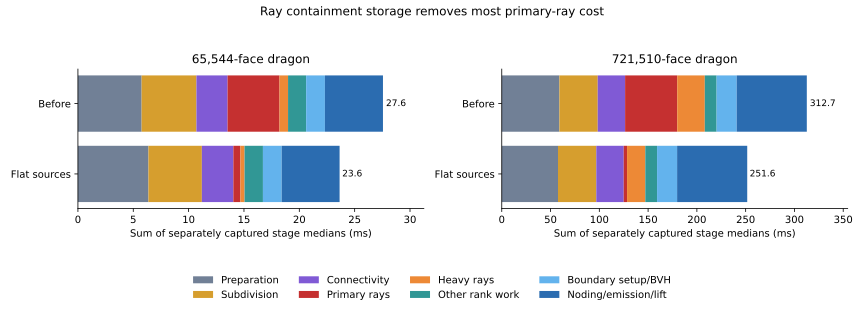

# Ray containment storage and detailed GPU profiling

17 October 2026. Detailed timings identified ray traversal/containment as the
largest part of rank assignment. Storing projected source vertices in flat
arrays substantially reduces that cost. This is a representation change with
the same geometric tests and asymptotics; it does not reduce candidate work or
solve finite-boundary construction.

## Timing method

Pure Warp 1.15.0 on the shared NVIDIA L40, driver 570.158.01, with a four-core
CPU quota. Full replay timings include projection, topology, BVHs, subdivision,
connectivity, ranks, boundary noding and conforming world-space output. Upload,
allocation, JIT, capture, readback, audit and rendering are excluded. Each run
uses two warmup replays followed by five CUDA-event measurements; tables report
medians. GPU benchmark jobs run sequentially. Other host jobs continue running;
these are current-load measurements, not isolated-machine claims.

The baseline is commit `a508de6`. JSON reports retain module/input checksums,
capacities and load snapshots. Detailed diagnostics capture each stage in its
own graph; **their medians do not sum to the complete-graph median**. The baseline
diagnostics use the retained [profiling-only patch](baseline-profiling.patch),
which splits orchestration methods without changing kernels or their order.
Complete baseline benchmarks use the unmodified commit.

## What changed

The old primary and heavy ray kernels passed a 32-vertex binary64 polygon value
to each candidate containment test. The new preparation pass copies projected
sources to an eight-vertex flat array plus a separate count. A triangle clipped
against one near plane and four image-window planes has at most eight vertices;
overflow still sets the sticky failure flag. The ray loops load individual
endpoints directly, retaining the same cross products, loop order and half-open
ownership of shared edges. No quantization or new geometric tolerance is added.

The cache is rebuilt on every replay, so camera, geometry and topology values
can change within the captured graph. It adds 132 bytes per input face, about
90.8 MiB on the full dragon. Allocation remains outside replay; all work remains
on device. Source-labelled output, connectivity, subdivision, sorting and
meshing algorithms are unchanged. The exact CPU reference is unchanged.

The [algorithm description](../../warp_peel/EVENTS.md) documents the complete
pipeline and its accepted input contract. Surface intersections must already be
resolved, and positive-area coincident overlap remains unsupported.

## Detailed costs



| Stage | 64K before (ms) | 64K after (ms) | Full before (ms) | Full after (ms) |
| --- | ---: | ---: | ---: | ---: |
| Preparation | 5.754 | 6.370 | 59.057 | 57.646 |
| Subdivision | 4.951 | 4.826 | 39.312 | 39.256 |
| Connectivity | 2.815 | 2.847 | 28.065 | 28.103 |
| Samples | 0.778 | 0.795 | 7.779 | 7.727 |
| Query sort | 0.271 | 0.272 | 1.052 | 1.047 |
| Grouping/certification | 0.169 | 0.176 | 1.036 | 1.030 |
| Primary rays | 4.689 | 0.633 | 53.421 | 3.439 |
| Heavy continuations | 0.774 | 0.379 | 28.260 | 18.695 |
| Hit sort/scan | 0.395 | 0.395 | 2.004 | 2.007 |
| Rank assignment | 0.021 | 0.021 | 0.247 | 0.244 |
| Boundary vertices/scan | 0.604 | 0.618 | 4.821 | 4.777 |
| Point bounds/BVH | 1.092 | 1.075 | 15.758 | 15.774 |
| Noding/emission/lifting | 5.243 | 5.232 | 71.872 | 71.865 |

Sources: [64K before](before-64k.json), [64K after](after-64k.json),
[full before](before-full.json), [full after](after-full.json).

The full dragon's primary ray stage falls from 53.42 to 3.44 ms; its heavy
continuations fall from 28.26 to 18.70 ms. This isolates a large representation
cost in the ray path, but it is not a hardware-counter diagnosis of memory
bandwidth, register spilling or atomic contention. Sample generation still
loads representative polygons by value. Query sorting plus hit sorting/scans
take only about 3.05 ms on the full dragon, so compacting those inputs alone
would have limited benefit.

Boundary noding, triangle emission and world lifting are fused and still take
71.86 ms on the full dragon. The diagnostic does not claim to distinguish those
three costs. Boundary scattering/scans and point-BVH construction add another
20.55 ms. Preparation, subdivision and connectivity remain about 57.65, 39.26
and 28.10 ms respectively. These are the next substantial targets; long-ray
continuations also retain 18.70 ms of work.

## Complete graph results

| Input | Before (ms) | Flat sources (ms) | Change |
| --- | ---: | ---: | ---: |
| 1,068 dragon | 3.268 | 3.132 | -4.1% |
| 2,088 dragon | 3.771 | 3.582 | -5.0% |
| 4,108 dragon | 5.122 | 4.716 | -7.9% |
| 8,200 dragon | 6.515 | 5.712 | -12.3% |
| 16,400 dragon | 10.343 | 8.433 | -18.5% |
| 32,792 dragon | 15.983 | 13.442 | -15.9% |
| 65,544 dragon | 27.815 | 23.490 | -15.6% |
| 102,400 sculpted | 18.975 | 18.699 | -1.5% |
| 721,510 dragon | 313.039 | 251.583 | -19.6% |

The full dragon improves by **19.6%**, from **313.039 to 251.583 ms**,
about four complete extractions per second. It emits all **26 layers** and
**5,440,541 triangles**. This remains well short of real time for the full model.
The 64K dragon improves by 15.6%; the 102K sculpted mesh gains only 1.5%, since
its connectivity already eliminates most ray work.

The identical-footprint 65,536-layer stack **regresses from 8.994 to 10.014 ms
(+11.3%)**; its one shared ray leaves little repeated containment work to remove,
while the flat cache still adds preparation. The 1,024-layer stack improves from
1.311 to 1.259 ms. Both check every assigned rank, preserve their work/output
counts, and pass the 15% timing guard. See [baseline](baseline-stacks.json),
[candidate](candidate-stacks.json), and [stack regression](stack-regression.json).
This optimization is not a universal speedup.

Sources: [scaling baseline](baseline-scaling.json),
[scaling candidate](candidate-scaling.json), [full baseline](baseline-full.json),
[full candidate](candidate-full.json). Each case retains the same polygon,
triangle and layer counts. Atomic append order can change representative choice
and small ray-work counts; those counters are not guaranteed deterministic.

## Correctness and regression checks

**135 GPU tests pass** ([test report](validation.xml)), covering source-labelled
exact-oracle regions, triangle coverage/reconstruction, shared-edge ownership,
clipping, prefixes, capacity failures, changed-input replay, and absence of
allocation/host-transfer graph nodes. The scaling sweep checks **6,390 rays**
and the full dragon checks **834**, for **7,224 rays with zero rank mismatches**.

The [complete 1K-dragon comparison](full-region-audit.json) checks **1,626
source/rank unions** against the independent exact global arrangement oracle.
There are **no failures**; maximum symmetric-difference area is
**6.788 × 10⁻¹⁴**. Conversion repairs 120 oracle polygons and zero GPU polygons;
GPU output buffers themselves are never repaired.

The [scaling](scaling-regression.json), [full-dragon](full-regression.json), and
[stack](stack-regression.json) regression gates pass. Stack benchmarks verify
every rank. Recorded module hashes were checked against the actual measured
baseline, profiling-only baseline, and final optimized sources.

Timing/output-count gates are not geometry certificates. GPU geometry remains
finite precision. The large-scene rational ray audits sample source-labelled
ranks rather than proving every output region correct. The complete 1K oracle
comparison converts both sides to binary64, repairs invalid converted polygons
when necessary and uses a 1e-12 comparison grid with a 1e-9 normalized-area
tolerance. It does not turn the GPU route into an exact solver.

## Reproduction

```bash
python3 scripts/profile_events.py results/global/dragon-cache/65536/resolved.json --detailed --out results/gpu-events-profile/after-64k.json
python3 scripts/profile_events.py results/dragon/scene.json --detailed --out results/gpu-events-profile/after-full.json
python3 scripts/benchmark_events.py results/global/dragon-cache/{1024,2048,4096,8192,16384,32768,65536}/resolved.json results/large/scenes/sculpted-102400.json --audit --out results/gpu-events-profile/candidate-scaling.json
python3 scripts/benchmark_events.py results/dragon/scene.json --audit --out results/gpu-events-profile/candidate-full.json
python3 scripts/benchmark_event_stacks.py --sizes 1024 65536 --out results/gpu-events-profile/candidate-stacks.json
TMPDIR=/home/horde/.cache/peel-tmp python3 -m pytest tests/gpu -q --junitxml=results/gpu-events-profile/validation.xml
python3 scripts/validate_event_dragon.py results/global/dragon-cache/1024/resolved.json --work /path/outside/repo/oracle --out results/gpu-events-profile/full-region-audit.json
python3 scripts/check_event_performance.py results/gpu-events-profile/baseline-scaling.json results/gpu-events-profile/candidate-scaling.json
python3 scripts/check_event_performance.py results/gpu-events-profile/baseline-full.json results/gpu-events-profile/candidate-full.json
python3 scripts/report_event_profile.py
```

Use an isolated checkout of `a508de6` for baseline full-graph timings. For baseline
detailed profiles, apply `baseline-profiling.patch` there with
`git apply --unidiff-zero`. Do not benchmark the optimized code as its own baseline.
The existing regression gate allows at most 15% median slowdown on comparable
hardware/load, and requires matching output counts and successful ray audits.
