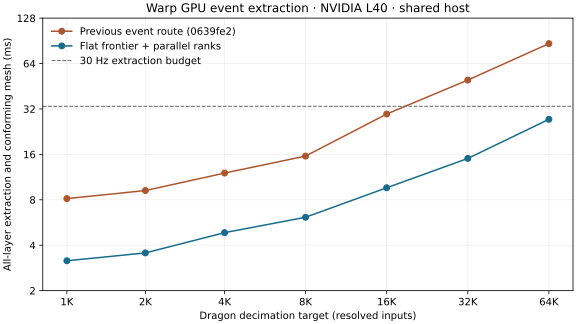

# Warp event extraction: flat frontiers and parallel ranks

This follow-up changes GPU work scheduling and storage while retaining the
contour-guided supporting-line subdivision. The exact CPU references remain
unchanged. Read the [implemented algorithm](../../warp_peel/EVENTS.md) for the
coverage certificate and the remaining numerical/asymptotic limitations.

## Fresh comparison

Both versions ran on the same NVIDIA L40, Warp 1.15.0, driver 570.158.01 and shared
host with a four-core CPU quota. Each case uses two warmups and five CUDA-event
measurements; the table reports medians. The baseline is commit `0639fe2`, loaded
from a separate snapshot of its Python modules/scripts. Input checksums match.
GPU jobs were sequenced for these timing comparisons; the machine was not
reserved. Case-start GPU process/load snapshots are retained, not continuous
proof of isolation. See [baseline](baseline.json) and [candidate](benchmark.json).

Scope includes projection, topology, BVHs, all ranks, conforming triangulation
and 3D lifting. Upload, allocation, JIT, capture, readback, preprocessing and
validation are excluded. These are device extraction rates, not complete
application frame rates.

| Resolved faces | Previous event route, ms | Current, ms | Speedup |
| ---: | ---: | ---: | ---: |
| 1,068 | 8.15 | 3.16 | 2.58× |
| 2,088 | 9.22 | 3.56 | 2.59× |
| 4,108 | 12.04 | 4.85 | 2.48× |
| 8,200 | 15.59 | 6.13 | 2.54× |
| 16,400 | 29.62 | 9.62 | 3.08× |
| 32,792 | 49.75 | 15.04 | 3.31× |
| 65,544 | 86.77 | 27.34 | 3.17× |
| 102,400 | 53.87 | 21.22 | 2.54× |

The first seven rows are the cached dragon decimations; the last is the sculpted
mesh. Every case retains the same polygon, triangle and layer counts. Counts
alone are not a correctness certificate; independent validation is below.
The 64K case now fits a 30 Hz extraction budget, and the 102K case takes 21.2 ms.



## Full README dragon

The original **721,510-face** `xyzrgb_dragon-720K.ply` example, with its recorded
camera and resolved-input contract, completes all **26 layers in 323.65 ms**.
It emits **1,383,441 convex polygons and 5,440,541 conforming triangles**. The
case-start GPU snapshot records about 16 GiB allocated/resident; this is not a
peak-memory measurement. No capacity override was required. A fresh run of
`0639fe2` takes **896.57 ms** with the same output counts: a **2.77×** improvement.
See [current](full-dragon.json) and [previous](baseline-full-dragon.json) results.

The independent rational-ray audit found **zero mismatches in 834 checked rays**,
with no boundary skips. That is sampled evidence, not a complete large-scene
certificate. This is approximately **3.1 extractions/second**, so the full model
still misses the real-time goal. The README's existing Blender images remain the
previously recorded CPU outputs; this timing does not relabel them as GPU renders.

## What changed

- Frontier vertices and counts live in flat arrays. Splitting writes directly to
  the next frontier instead of manipulating several by-value polygon matrices.
  Geometry predicates and cleanup thresholds retain the original GPU policy.
- Hit gathering traverses once, appending bounded records and counting per group.
  After 32 candidates, a query hands its remaining DFS suffix to parallel,
  disjoint subtree tasks. Worker partitioning adapts to the number of heavy rays.
- Conditional graph branches select hit-sort length from device counts. Native
  scratch is prewarmed at maximum capacity; replay never allocates or reads counts
  on the host. Other sorts, scans and BVHs still have capacity-dependent costs.
- A rectangle certificate can share ordering between distinct samples. All BVH
  candidates must strictly cover all four rectangle corners. Failure retains
  separate queries. This certificate relies on pre-resolved input intersections.
- Meshing schedules actual polygon edges instead of 32 lanes per polygon. Both
  GPU routes call the same geometric meshing function.
- Event extraction skips the unused iterative contour-BVH build and allocation
  of iterative polygon frontiers/residual BVH storage.

## Stage costs and heavy-ray control

| Stage | Previous 64K, ms | Current 64K, ms | Current full dragon, ms |
| --- | ---: | ---: | ---: |
| Projection/topology/BVHs | 7.27 | 5.41 | 57.27 |
| Contour subdivision | 39.34 | 4.71 | 39.59 |
| Rank assignment | 18.86 | 9.29 | 134.94 |
| Conforming mesh | 20.93 | 6.86 | 92.37 |

Each stage is a separately captured graph, with two warmup sequences and five
measurements. Their medians are diagnostic and do not sum exactly to the
complete-graph median. See [previous](baseline-phases.json), [current](phases.json)
and [full-model](full-dragon-phases.json) profiles.

Subdivision's execution cost drops substantially without reducing its candidate
or split counts. The remaining full-model costs are led by **rank assignment
(135 ms)** and **meshing (92 ms)**, followed by rebuilding projection/topology/BVHs
(57 ms). Reducing extra fragments and sharing more depth order remain valuable;
optimizing the subdivision kernel alone cannot reach real time on this model.

The 65,536 identical-footprint stack drops from **471.19 ms to 9.70 ms** for the
complete pipeline, approximately **48.6×**. It still emits and verifies every rank.
Ray candidates fall from 2K to K; the new rank stage takes **1.14 ms**. Preparation
is now the largest stage on this control. See [previous](baseline-stack.json),
[current scaling](stacks.json) and [stage profile](stack-phases.json).

## Shared-order control

Nested, strictly shrinking triangle footprints at increasing depths produce
distinct interior seeds but no actual clipping. The new certificate shares their
rank order. At K=1,024, it performs **1,024 certification candidates plus 1,024 ray
candidates**, versus **1,048,576 ray candidates** with sharing disabled. All K
ranks are checked. Tests also use tilted parallel planes: ranks must evaluate
depths at each target sample, even when the ordering is shared.

Complete extraction is **10.47 ms with sharing versus 13.71 ms without**. The
remaining contour broad phase is still quadratic on this control; reduced rank
work is not a general linear-pipeline claim. The unshared control explicitly
allocates K² hit slots to avoid a capacity failure. See [shared](nested.json) and
[unshared](nested-unshared.json) records and the benchmark source.

On realistic inputs, disabling the rectangle proposals takes **27.48 ms**
for the 64K dragon and **20.41 ms** for the sculpted mesh, versus
27.34 ms and 21.22 ms with proposals enabled. The
optimization changes both grouping and query order; these timings do not isolate
certificate success alone. It adds modest overhead on the sculpted case. See the
[ablation](unshared.json); the device constructor and benchmark CLI expose disabling it.

Stack/control and the final 64K/stack stage measurements ran while the full-dragon audit was
CPU-bound with its GPU allocations still resident. There were no concurrent GPU
extraction launches from that audit during those measurements. Results remain
measurements under shared load, not reserved-device guarantees.

## Validation

[115 GPU tests](validation.xml) pass, including the original iterative route,
exact-oracle fixture comparisons, prefixes, reconstruction, seams, non-manifold
edges, capacity errors and graph replay without allocations or host transfers.
New controls cover non-power-of-two heavy trees, disjoint heavy groups, distinct
shared seeds on tilted parallel surfaces, and a captured graph replaying across
small/large/small hit-sort buckets.

All eight realistic-case audits report **zero rank mismatches across 6,390 checked
rays**. Their samples include a fixed grid, output interiors and retained
regression rays; they do not certify every output region.

The [complete 1K comparison](full-region-audit.json) checks 1,626 source/rank
unions against the exact global oracle. Maximum normalized symmetric-difference
area is `6.787982448266255e-14`, below the `1e-9` test tolerance. Both outputs are
converted to binary64 and snapped to a `1e-12` comparison grid; 120 oracle polygons
needed repair after conversion, versus zero GPU polygons. This is a numerical
full-region comparison, not an exact arithmetic certificate.

The [performance regression gate](regression.json) requires matching input
checksums, successful ray audits, unchanged output counts and candidate medians
no more than 15% above baseline. All eight cases pass. Run it only with comparable
hardware/load; timing thresholds do not belong in an uncontrolled unit-test job.

## Remaining gaps

Supporting-line cuts still produce extra subdivisions, and descendants repeat
some candidate work. The flat frontier improves execution cost, not that
geometric complexity. A collapsed-child cut carries the parent and an empty
reserved sibling forward; this can increase frontier occupancy/task visits
without changing output regions.

The rectangle certificate accepts only one of 436 attempted groups on the 64K
dragon. It does not share order across internal source-face boundaries or general
changing footprints. Unshared Q samples crossing K surfaces can still perform
QK work. Finite-segment event assembly and broader certified order propagation
remain algorithmic work.

Prefixes still construct all ranks. Topology/BVHs rebuild each replay. Storage
is bounded with explicit overflow failure; there is no device spill/retry path.
Binary64 geometry, padded binary32 bounds and cleanup tolerances remain finite
precision, with no GPU exact fallback. The inherited depth-tie counter is still
uninstrumented for this route.

## Reproduce

```bash
TMPDIR=/home/horde/.cache/peel-tmp python3 -m pytest tests/gpu -q
python3 scripts/benchmark_events.py results/global/dragon-cache/{1024,2048,4096,8192,16384,32768,65536}/resolved.json results/large/scenes/sculpted-102400.json --audit --out results/gpu-events-tuning/benchmark.json
python3 scripts/benchmark_events.py results/dragon/scene.json --audit --out results/gpu-events-tuning/full-dragon.json
python3 scripts/profile_events.py results/global/dragon-cache/65536/resolved.json --out results/gpu-events-tuning/phases.json
python3 scripts/profile_events.py --stack 65536 --out results/gpu-events-tuning/stack-phases.json
python3 scripts/profile_events.py results/dragon/scene.json --out results/gpu-events-tuning/full-dragon-phases.json
python3 scripts/benchmark_event_stacks.py --out results/gpu-events-tuning/stacks.json
python3 scripts/benchmark_event_stacks.py --nested --sizes 64 256 1024 --out results/gpu-events-tuning/nested.json
python3 scripts/benchmark_event_stacks.py --nested --no-share-regions --sizes 64 256 1024 --out results/gpu-events-tuning/nested-unshared.json
python3 scripts/check_event_performance.py results/gpu-events-tuning/baseline.json results/gpu-events-tuning/benchmark.json --out results/gpu-events-tuning/regression.json
python3 scripts/validate_event_dragon.py results/global/dragon-cache/1024/resolved.json --work /home/horde/.cache/peel-events-global-1024 --out results/gpu-events-tuning/full-region-audit.json
python3 scripts/report_event_tuning.py
```

For a fresh baseline, check out `0639fe2` separately and run its benchmark scripts
on the same inputs. The `*-single-pass.json`, `*-flat-mesh.json`,
`*-block32.json`, `*-balanced.json` and `*-flat-frontier.json` files are exploratory
intermediate stage diagnostics, not measurements of the final source snapshot.
They do not carry source hashes. Use the final benchmark's recorded hashes and
final phase files for the published comparison.
