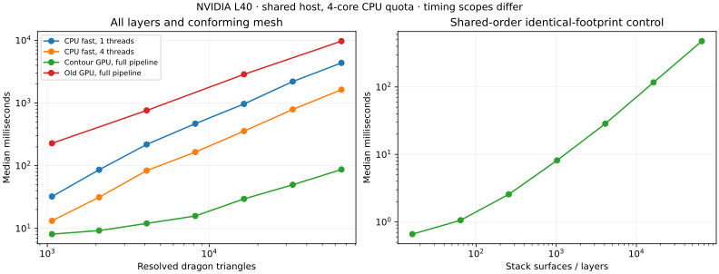

# Contour/shared-rank GPU prototype

The new `EventPeeler` computes all layers in **86.9 ms for the 64K dragon** and
**54.1 ms for the 102K sculpted mesh**, including conforming 3D mesh generation.
Fresh four-thread CPU fast medians are **1,630.3 ms** and **191.6 ms**. The old GPU
route takes **9,691.7 ms** and **1,294.8 ms** in this comparison. This is a measured
improvement, not a claim that the general near-real-time problem is solved.

The [algorithm/API](../../warp_peel/EVENTS.md) explains the contour-driven convex
subdivision, shared ray groups, numerical contract and remaining redundant work.
Select it explicitly using `python3 -m warp_peel ... --method events`; the original
iterative route remains the default baseline. Both GPU routes remain entirely on
device and graph capturable. No custom CUDA/C++ extension was added.

## All-layer timings

All times below are milliseconds; ratios compare the recorded medians.

| Input | CPU 1 thread | CPU 4 threads | Old GPU | Contour GPU | CPU 4 / GPU |
| --- | ---: | ---: | ---: | ---: | ---: |
| Dragon 1,068 | 32.2 | 13.2 | 227.8 | **8.1** | 1.6× |
| Dragon 2,088 | 86.0 | 31.3 | — | **9.2** | 3.4× |
| Dragon 4,108 | 218.3 | 83.5 | 760.6 | **12.0** | 7.0× |
| Dragon 8,200 | 468.0 | 164.9 | — | **15.8** | 10.4× |
| Dragon 16,400 | 965.9 | 356.0 | 2866.7 | **29.6** | 12.0× |
| Dragon 32,792 | 2199.1 | 788.8 | — | **49.6** | 15.9× |
| Dragon 65,544 | 4363.0 | 1630.3 | 9691.7 | **86.9** | 18.8× |
| Sculpted 102,400 | 470.9 | 191.6 | 1294.8 | **54.1** | 3.5× |

GPU: NVIDIA L40, Warp 1.15.0, driver 570.158.01. New GPU numbers are five timed
CUDA-event graph replays after two warmups; old GPU numbers use three timed
replays after two warmups. Both include validation, projection, topology,
visibility/ranks, boundary noding and world-space mesh generation. Both exclude
upload, allocation/JIT/capture, readback, audits and intersection preprocessing.

CPU: unchanged release `fast-bvh-peel --resolved-mesh`, one and four OpenMP
threads, `OMP_WAIT_POLICY=PASSIVE`. Discard the first of four repetitions and
report the median of the other three. CPU timing includes extraction and
conforming meshing, but **excludes import/projection/topology**, so this is not an
identical-scope end-to-end speedup. CPU uses its fixed-grid numeric policy; GPU
uses binary64 and produces different subdivisions. Neither is exact.

The host has a four-core CPU quota. Runs were sequential within this experiment,
with no overlap between its final new-GPU, CPU, old-GPU or test jobs. No machine
reservation was made. Final GPU case-start snapshots show only the benchmark
process, but those snapshots do not establish isolation throughout a run. These
are current-load measurements, as requested; the older CPU records were under
different load and are not substituted for the fresh comparison.

The 64K result corresponds to roughly 11.5 extractions/second; the 102K result to
18.5. These are device extraction rates, not complete application frame rates.
A stable 30–60 Hz target is still unmet for these full pipelines.

## Correctness evidence

The combined GPU suite passes **108 tests**, including the independent exact
arrangement fixture comparisons, resolved crossing cases, source reconstruction,
holes, closed and non-manifold surfaces, prefixes, failure flags, changed-input
replay and graph checks prohibiting host transfers/allocation nodes. See
[validation.xml](validation.xml). Crossing fixture preprocessing is outside the
GPU contract and timing. Exact CPU solvers remain unchanged.

A [complete 1K dragon region comparison](full-region-audit.json) checks 1,626
source/rank unions against the exact contour-aware global oracle. The largest
symmetric-difference area is **6.79e-14** in the normalized image, below the
1e-9 test tolerance. The comparison converts rational coordinates to binary64
and applies a 1e-12 comparison grid to both sides. Direct GEOS union initially
failed on near-coincident oracle constructions; 120 oracle polygons become
invalid after float conversion and are made valid before snapping. No GPU
polygons required that repair. This is a complete numerical set comparison,
not an exact arithmetic certificate or a modification to GPU output geometry.

Independent rational-ray audits, including the saved regression rays, found:

| Input triangles | Checked rays | Rank mismatches |
| --- | ---: | ---: |
| 1,068 | 828 | 0 |
| 2,088 | 830 | 0 |
| 4,108 | 834 | 0 |
| 8,200 | 836 | 0 |
| 16,400 | 833 | 0 |
| 32,792 | 835 | 0 |
| 65,544 | 837 | 0 |
| 102,400 | 557 | 0 |

That is **0 mismatches across 6,390 checked rays**. Each case includes a fixed
image grid plus sampled output interiors; these are sampled checks, not a full
correctness certificate. Region partitions and output-interior sample locations
can differ between implementations/replays. Do not infer a controlled accuracy
ranking from the old solver's mismatch counts.

## Why the work changed

On the 64K dragon the new pipeline emits 129,909 convex patches and 517,417
triangles, versus 354,170 patches and 1,652,451 triangles in the fresh old-GPU run.
It processes 8,977 unique contours, 194,274 frontier task visits and 308,956
contour candidate tests. Shared rank queries gather 560,564 hits in 126,917
location groups, with 3,664,880 candidate visits across count and fill. These
operations differ from the old per-layer polygon candidate tests and should not
be treated as equivalent units of work.

The [separately captured phase diagnostic](phases.json) reports medians:

| Stage, 64K dragon | ms |
| --- | ---: |
| Projection/topology/contour and source indexing | 6.4 |
| Contour subdivision | 35.3 |
| Shared hit queries and rank sorting | 18.9 |
| Boundary noding and mesh output | 18.5 |

These diagnostic medians are not additive measurements of the full graph median.
Clipping is no longer 99% of runtime. Further work should examine unnecessary
supporting-line cuts, frontier depth, heavy ray-group cooperation, padded sort
capacities and meshing. This experiment does not establish register-spill or
occupancy causes with hardware counters.

## Stack scaling control

For K coincident triangular footprints at different depths, the implementation
produces three unique contours, no splits, one ray group, K stored hits, at most
3K contour tests and exactly 2K ray candidate visits (count plus fill). Every
source receives its expected rank. Tests also vary cyclic vertex ordering.

The measured K=16, 64, 256, 1,024, 4,096, 16,384 and 65,536 cases take about
0.66, 1.06, 2.57, 8.17, 28.56, 116.69 and 476.51 ms respectively. This demonstrates
linear geometric work in this control, not universal output-sensitive complexity.
A single heavy shared ray still traverses serially. A [separate stack stage
profile](stack-phases.json) puts 453.2 ms in rank assignment, versus 6.8 ms in
preparation, 1.2 ms in subdivision and 10.9 ms in meshing. Cooperative heavy-group
traversal is therefore a targeted next experiment; hardware counters would still
be needed to separate traversal, atomics and sorting costs within that stage.

Supporting lines can create extra cuts. Different sample locations do not yet
share depth order, and distinct queries can still incur quadratic aggregate work
in adverse overlapping configurations. Prefixes construct all ranks before
suppressing later output. These limitations prevent treating the prototype as
completion of every goal in the [strategy review](../../warp_peel/STRATEGY.md).

## Records and reproduction

- [benchmark.json](benchmark.json): final new-GPU timings, capacities, source/input
  hashes, load snapshots, work counters and rational-ray audits.
- [old-gpu.json](old-gpu.json): fresh iterative GPU measurements; gaps in the table
  were not measured in this comparison.
- [cpu/summary.json](cpu/summary.json): fresh CPU timings, executable hash, CPU
  quotas and links to individual metrics files.
- [stacks.json](stacks.json): full stack timing arrays and verified work counts.
- [phases.json](phases.json): separate captured-stage diagnostics.
- [full-region-audit.json](full-region-audit.json): complete numerical set comparison against exact global regions for the 1K dragon.
- `pilot.json`, `initial-capacities.json`: exploratory runs with earlier, larger
  pools/counters. They are not the final comparison; the initial 102K timing also
  overlapped this experiment's tests. Their hashes identify intermediate code.

Run commands are in [EVENTS.md](../../warp_peel/EVENTS.md). Regenerate the table and
plot with `python3 scripts/report_events.py`. Source hashes in the final benchmark,
stack and old-GPU records were checked against the committed Python sources.
