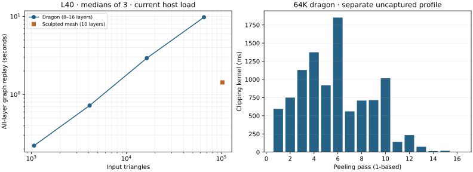

# Warp GPU results

Measured on NVIDIA L40, Warp 1.15.0, driver 570.158.01, on a shared machine.
This implementation completes all-layer, analytic GPU extraction and graph
replay. **It does not yet meet the near-real-time performance goal and is not
an exact correctness oracle.** The CPU implementations remain available.

## Full graph replay

| Input | Resolved triangles | Layers | Median replay | Output triangles |
| --- | ---: | ---: | ---: | ---: |
| Dragon | 1,068 | 8 | 0.221 s | 21,568 |
| Dragon | 4,108 | 12 | 0.724 s | 116,123 |
| Dragon | 16,400 | 14 | 2.925 s | 453,651 |
| Dragon | 65,544 | 16 | 9.767 s | 1,654,986 |
| Sculpted mesh | 102,400 | 10 | 1.430 s | 427,042 |

Three CUDA-event repetitions follow JIT, capture and two complete warm-up replays.
Timing includes device input validation, welding, projection, topology/contours,
all hierarchy work, all peeling passes, boundary noding and world-space mesh
construction. Upload, allocation, JIT, graph capture, readback and audits are
excluded and setup costs are recorded separately. The earlier CPU measurements
exclude projection/topology setup, so these are not matched speedup comparisons.
The GPU route remains slower than the earlier CPU fast route on the 64K dragon.

[Raw repetitions, capacities, input/source hashes and process snapshots](benchmark.json).
No GPU reservation or interference control was applied. Other simulation/render
jobs ran during development; inspect the retained case-start snapshots for the
final run. The machine's CPU quota is shared as well. The distinct sculpted model
has substantially less residual work than the dragon; its 100K timing is not a
prediction for a 100K dragon. The full 721,510-face dragon is not GPU-benchmarked.



## Where the time goes

A separate, uncaptured 64K diagnostic records **10.098 s clipping**,
17.75 ms hierarchy work, 7.82 ms residual compaction,
15.78 ms preparation and 53.61 ms meshing.
Clipping accounts for **99.1%** of that diagnostic. Its phase
sum is not the graph-replay median: event boundaries include host launch gaps
and the run has its own scheduling/load conditions. [Per-layer events](phases.json).

The next GPU work should target the long, divergent per-target clipping loops
and large fixed polygon temporaries: compact work queues, more parallel clipping,
and data layouts that reduce copies/register spills. Hierarchy polishing is not
supported as the priority by this profile. Later layers usually get cheaper, but
fragment distribution and work imbalance keep the decline irregular. Private
clipping scratch alone consumes about 12.2 GiB with the large default capacities;
a packed device pool would improve memory use as well as scheduling flexibility.

## Correctness and capture checks

**55 integration checks pass**, including 35 accepted fixtures compared with the
original exact arrangement oracle. The source-labelled region and triangle unions
must agree to normalized image-area tolerance `1e-9`; this is a finite-tolerance
check, not a proof that sub-resolution features are preserved. Checks also cover
source-plane reconstruction, reprojection, selected T-junction cases, prefix
extraction, graph replay after device vertex/camera changes, multiple workspaces,
empty inputs, invalid device indices/cameras, explicit capacity errors and two
numerical regressions (a short clipping edge and a tiny backtracking edge).
[Validation summary](validation.json), [individual cases](validation.xml).

Capture checks prohibit host reads/synchronization during recording and inspect
the CUDA graph: conditional control flow is present, host/device transfers and
allocation nodes are absent. Device-to-device copies used by Warp primitives are
allowed. `warp_gpu` also passes through the optional CTest integration.

Independent rational ray/triangle tests compare the complete source-labelled
hit stack with downloaded GPU polygons, using a fixed grid, output-interior
samples and retained failing-ray probes:

| Input | Triangles | Nonempty rays checked | Rank mismatches |
| --- | ---: | ---: | ---: |
| Dragon | 1,068 | 828 | 2 |
| Dragon | 4,108 | 834 | 0 |
| Dragon | 16,400 | 833 | 0 |
| Dragon | 65,544 | 837 | 0 |
| Sculpted mesh | 102,400 | 557 | 0 |

[Raw audits and mismatch examples](audits.json). A mismatch means a sampled ray's
layer/source sequence differs from the rational source intersections; this can
include omitted coverage, extra coverage or a wrong rank. Such failures remain
limitations of this approximate implementation. Passing samples do not certify
whole regions. Padded floating source bounds accelerate the rational tests;
queries within `1e-11` of an output boundary are excluded. The audit includes
[retained regression rays](../../tests/gpu/regression_rays.json), so historical
failing locations remain visible even when output subdivisions change.

Output order and some subdivisions vary across runs because atomics determine
append order, which can change candidate order and floating rounding. The
benchmark and audit therefore need not emit identical triangle counts. Interior
samples also depend on the resulting subdivision; mismatch counts across runs
are not a controlled comparison on an identical ray set. The fixed grid and
explicit regression probes are repeatable.

The two numerical fixes evaluate clipping edges relative to their own endpoint
and use a translation-stable polygon area/perimeter cleanup. No convex hull is
used to expand the visible set. Geometry is still binary64, with a spatial
resolution threshold near `1e-10`, and does not acquire the CPU solver's exact
predicates or guarantees. Positive-area depth ties use dense source indices;
CPU exact mode instead rejects them.

## Reproduce

From the repository root, with the CPU exact executable already built:

```bash
python3 -m pip install -r requirements-gpu-test.txt
python3 -m pytest tests/gpu -q --junitxml=results/gpu/validation.xml
python3 scripts/benchmark_gpu.py results/global/dragon-cache/{1024,4096,16384,65536}/resolved.json results/large/scenes/sculpted-102400.json --repetitions 3
python3 scripts/audit_gpu.py results/global/dragon-cache/{1024,4096,16384,65536}/resolved.json results/large/scenes/sculpted-102400.json
python3 scripts/profile_gpu.py results/global/dragon-cache/65536/resolved.json
python3 scripts/report_gpu.py
```

The profiler's host loop is deliberately confined to that uncaptured diagnostic;
the actual extractor uses a device conditional loop. See the
[device API and algorithm](../../warp_peel/README.md) for graph composition,
stream lifetime, input assumptions and mandatory device error-flag handling.
